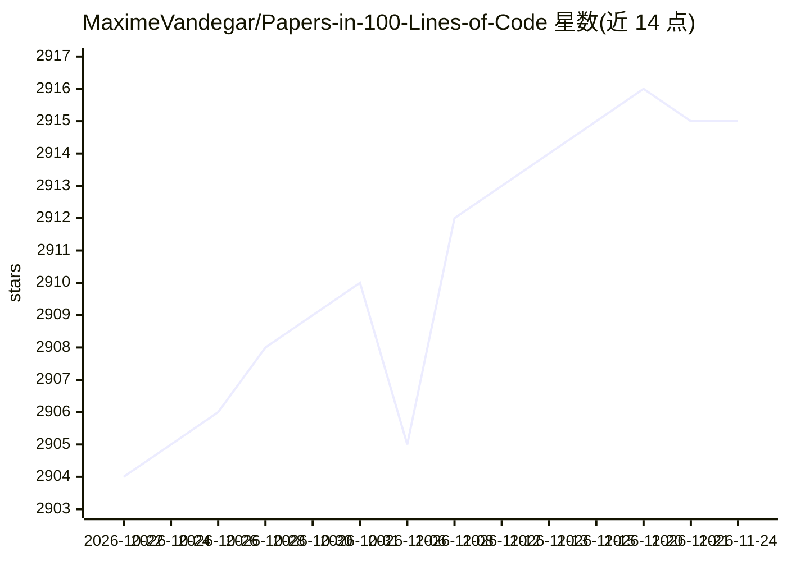

# MaximeVandegar/Papers-in-100-Lines-of-Code

⭐ 2,917 · Python · MIT · 推送 2026-10-22 · [GitHub](https://github.com/MaximeVandegar/Papers-in-100-Lines-of-Code) · 个人维护

**以每篇百行代码实现经典 AI 论文的教育性代码集**

收录 2013–2021 年间的深度学习论文实现集合，覆盖强化学习（DQN、PPO、Double Q-learning）、生成模型（GAN 系列、VAE、流模型、扩散模型）、优化方法（Adam、RMSProp）、归一化技术（BatchNorm、GELU、RMSNorm）、元学习（MAML）与神经渲染（NeRF、pixelNeRF、KiloNeRF）等方向。每条目附 arXiv/nature/PMLR 论文链接、作者与日期。README 未展示各实现的具体安装或运行说明，采用 MIT 许可，欢迎社区贡献。

## 筛选速览

| 维度 | 判定 | 备注 |
|---|---|---|
| AI 角色 | `ai-knowledge` | 知识聚合/清单类 |
| 许可风险 | `permissive` | MIT |
| 部署形态 | `None` |  |
| 模型依赖 | — | README 未给出锁定关系 |
| 硬件要求 | — | 无带数字的原话,不猜 |
| 安装摩擦 | `low` | 无编译、无系统依赖或容器化 |
| 成熟度 | — | 结构信号不足 |

## 能力要点

- 按论文逐条列出实现，附论文链接、作者与发表日期
- 覆盖强化学习、生成模型、优化器、归一化、元学习、神经渲染等多个方向
- 定位为百行代码规模的论文实现（educational）
- MIT 许可，欢迎贡献

## 适用场景

- 对照原论文阅读最小化的实现代码
- 查找 GAN、VAE、扩散模型、NeRF 等经典方法的简短实现
- 作为深度学习课程或自学的代码参考材料

## 场景标签

`教程课程` · 领域:学习与行业

## 证据(README 行号)

> L5: # Papers in 100 Lines of Code
> L7: Implementation of papers in 100 lines of code.
> L9: ## Implemented papers

## 星数曲线

2026-10-22 2,904 → 2026-11-24 2,915（+11）

---
*卡片 v1 · prompt 1.4 · 生成 2026-11-23 · 置信度 high · 依据 README sha `456b744ac8ea` · [字段定义](../../DATASET.md)*
