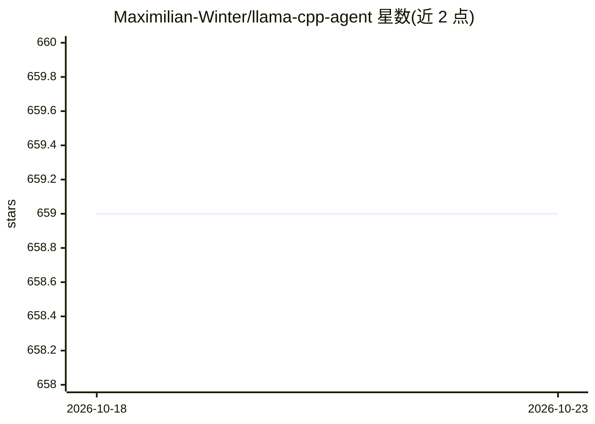

# Maximilian-Winter/llama-cpp-agent

⭐ 659 · Python · NOASSERTION · 推送 2026-03-09 · [GitHub](https://github.com/Maximilian-Winter/llama-cpp-agent) · 个人维护

**给开发者的 LLM Agent 框架：聊天、函数调用与结构化输出**

面向开发者的 Python LLM 交互框架，提供聊天界面、单个与并行函数调用、结构化输出生成、带 colbert 重排的 RAG 以及带工具的 Agent 链（会话式、顺序、映射链）。通过语法与 JSON schema 的引导采样约束模型输出，使未经函数调用微调的模型（如多数 7B 模型）也能完成函数调用与 JSON 输出。后端兼容 llama.cpp server、llama-cpp-python 及其 server、TGI 与 vllm。README 顶部声明项目不再维护，建议改用 ToolAgents。

## 筛选速览

| 维度 | 判定 | 备注 |
|---|---|---|
| AI 角色 | `ai-ecosystem` | LLM/agent 周边工具 |
| 许可风险 | `none` | NOASSERTION |
| 部署形态 | `library` | 以包/库形式分发 |
| 模型依赖 | local-ok | 支持本地模型 |
| 硬件要求 | — | 无带数字的原话,不猜 |
| 安装摩擦 | `low` | 无编译、无系统依赖或容器化 |
| 成熟度 | — | 结构信号不足 |

## 能力要点

- 引导采样使未微调模型可执行函数调用与结构化输出
- 支持单个与并行函数调用
- Agent 链（会话式/顺序/映射）与带 colbert 重排的 RAG
- 兼容 llama.cpp server、llama-cpp-python、TGI、vllm 多种后端

## 适用场景

- 让本地或 API 上的 LLM 执行函数调用与并行调用
- 从非结构化文本生成结构化数据对象
- 构建带工具的顺序或映射处理链，如多文章汇总

## 场景标签

`Agent 框架` `RAG` · 领域:Agent 开发

## 证据(README 行号)

> L12: The llama-cpp-agent framework is a tool designed to simplify interactions with Large Language Models (LLMs). It pro
> L25: - **Multiple Providers**: Works with llama-cpp-python, llama.cpp server, TGI server and vllm server as provider!

## 星数曲线

2026-10-18 659 → 2026-10-23 659（+0）

---
*卡片 v1 · prompt 1.4 · 生成 2026-10-21 · 置信度 high · 依据 README sha `a896c0341dec` · [字段定义](../../DATASET.md)*
