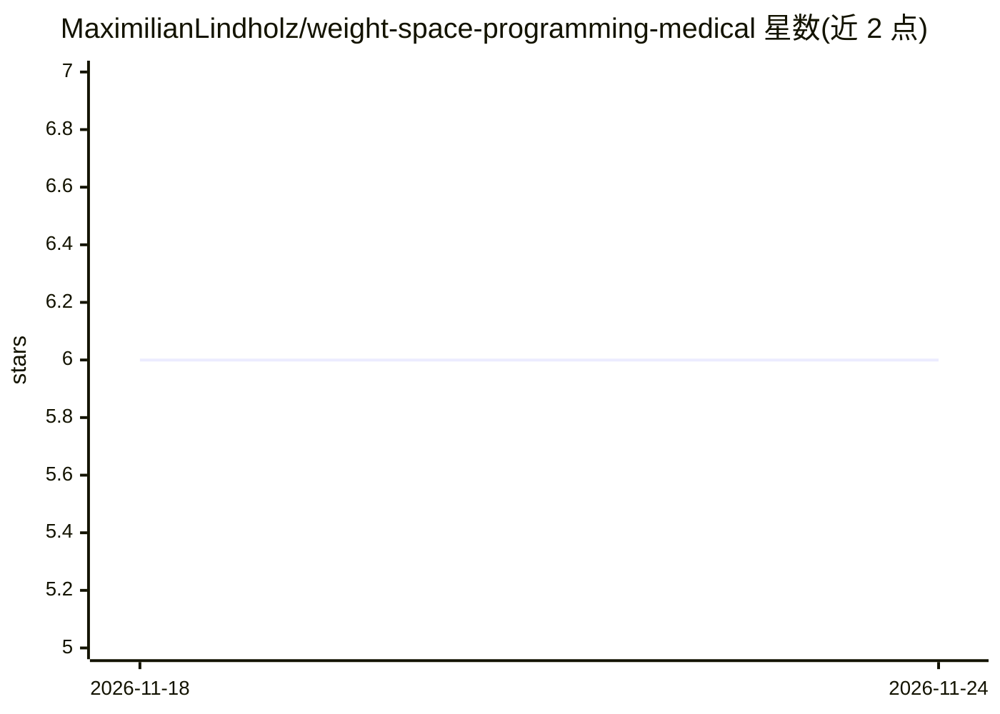

# MaximilianLindholz/weight-space-programming-medical

⭐ 7 · Python · MIT · 推送 2026-11-17 · [GitHub](https://github.com/MaximilianLindholz/weight-space-programming-medical) · [官网](https://arxiv.org/abs/2611.12066) · 个人维护

**论文复现仓库：LLM 直接写出医学影像分类器权重，免训练**

arXiv:2611.12066 的代码、LLM 调用与结果集合：让 Claude Opus 与 GPT 在单次回复中直接写出一个小型 CNN（ProgNet，591-6,974 个权重）的全部权重，不使用训练数据与梯度下降。覆盖 7 个任务（MedMNIST v2 的 5 个数据集与 SynthUterus 合成子宫 MRI），并将写出的网络与 MedSigLIP 零样本及 Adam 训练的同结构网络比较。提供 pip 依赖安装、build.sh 重评分脚本及各实验的运行命令；数据集不随仓库分发，需单独获取。

## 筛选速览

| 维度 | 判定 | 备注 |
|---|---|---|
| AI 角色 | `ai-knowledge` | 知识聚合/清单类 |
| 许可风险 | `permissive` | MIT |
| 部署形态 | `library` | 以包/库形式分发 |
| 模型依赖 | locked-api |  |
| 硬件要求 | — | 无带数字的原话,不猜 |
| 安装摩擦 | `low` | 无编译、无系统依赖或容器化 |
| 成熟度 | — | 结构信号不足 |

## 能力要点

- LLM 单次回复直接写出 CNN 全部权重，无训练数据、无梯度下降
- 7 个医学影像任务：MedMNIST v2 五个数据集 + SynthUterus
- 与 MedSigLIP 零样本和 Adam 训练网络作对照
- 权重分析显示 LLM 写出的过滤器稀疏、离散，呈教科书式边缘检测核

## 适用场景

- 复现论文中 LLM 写权重的医学分类实验
- 研究 LLM 生成权重与梯度训练权重的差异
- 在免训练设定下评估医学影像分类

## 场景标签

`科研工具` · 领域:学习与行业

## 证据(README 行号)

> L5: Code, LLM calls and results of the paper arXiv:2611.12066.
> L7: **Weight-space programming** (weight space programming, WSP): instead of training a neural network on data, a large
> L11: Two LLMs, Claude Opus 5.5 and GPT-6 Astra, write all weights of a small CNN (ProgNet, 591 to 6,974 weights) in a

## 星数曲线

2026-11-18 6 → 2026-11-24 6（+0）

---
*卡片 v1 · prompt 1.4 · 生成 2026-11-20 · 置信度 high · 依据 README sha `343477c2303d` · [字段定义](../../DATASET.md)*
