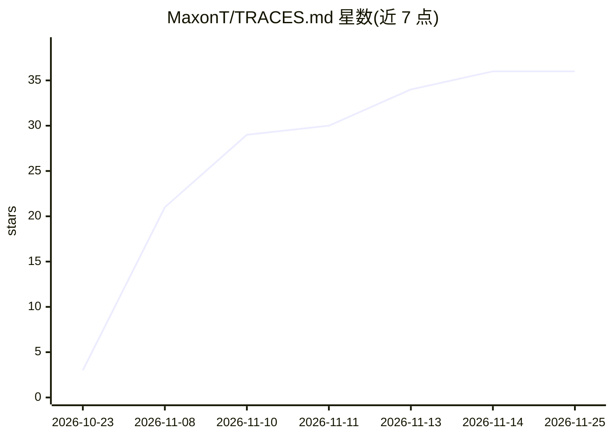

# MaxonT/TRACES.md

⭐ 36 · Python · MIT · 推送 2026-11-24 · [GitHub](https://github.com/MaxonT/TRACES.md) · [官网](https://maxont.github.io/TRACES.md/) · 个人维护 · 中文 README

**记录 AI agent 实际操作的开源追溯格式与 CLI**

一个开放格式加命令行工具：以每个任务一个仅追加的纯文本/JSONL 文件，按时间戳、工具、动作、结果逐行记录 agent 的每次调用，失败也如实记录。提供 init/run/append/validate/stats/fmt 等命令；validate 会拒绝隐瞒失败的记录（如 ok 旁边是非零退出码）。面向运行编码 agent 的开发者，用于错误分析与自我优化。Python 3.9+ 标准库实现，附 Docker 镜像与 JSON Schema，MIT 许可。

## 筛选速览

| 维度 | 判定 | 备注 |
|---|---|---|
| AI 角色 | `ai-ecosystem` | LLM/agent 周边工具 |
| 许可风险 | `permissive` | MIT |
| 部署形态 | `self-host` | docker 或自建部署 |
| 模型依赖 | — | README 未给出锁定关系 |
| 硬件要求 | — | 无带数字的原话,不猜 |
| 安装摩擦 | `low` | 无编译、无系统依赖或容器化 |
| 成熟度 | — | 结构信号不足 |

## 能力要点

- 每任务一个仅追加文件，每行一条 ts | tool | action | result 记录
- traces validate 拒绝隐瞒失败的 trace（如 ok 配非零退出码）
- Markdown 与 JSONL 双格式无损互转，带 JSON Schema
- 仅标准库依赖，Python 3.9+，支持 Docker 运行

## 适用场景

- 让编码 agent 运行时自动留下可回放的操作记录
- 分析各 agent/工具的失败率与错误模式
- 审计 agent 是否如实记录了失败步骤

## 场景标签

`LLM 可观测性` · 领域:评测与运维

## 证据(README 行号)

> L14: TRACES.md is a simple, open format for recording what AI agents did.
> L17: Think of TRACES.md as a **flight recorder for agents**: a dedicated, predictable place where every tool call, comma

## 星数曲线

2026-10-23 3 → 2026-11-25 36（+33）

---
*卡片 v1 · prompt 1.4 · 生成 2026-11-18 · 置信度 high · 依据 README sha `ea1fad7361f8` · [字段定义](../../DATASET.md)*
