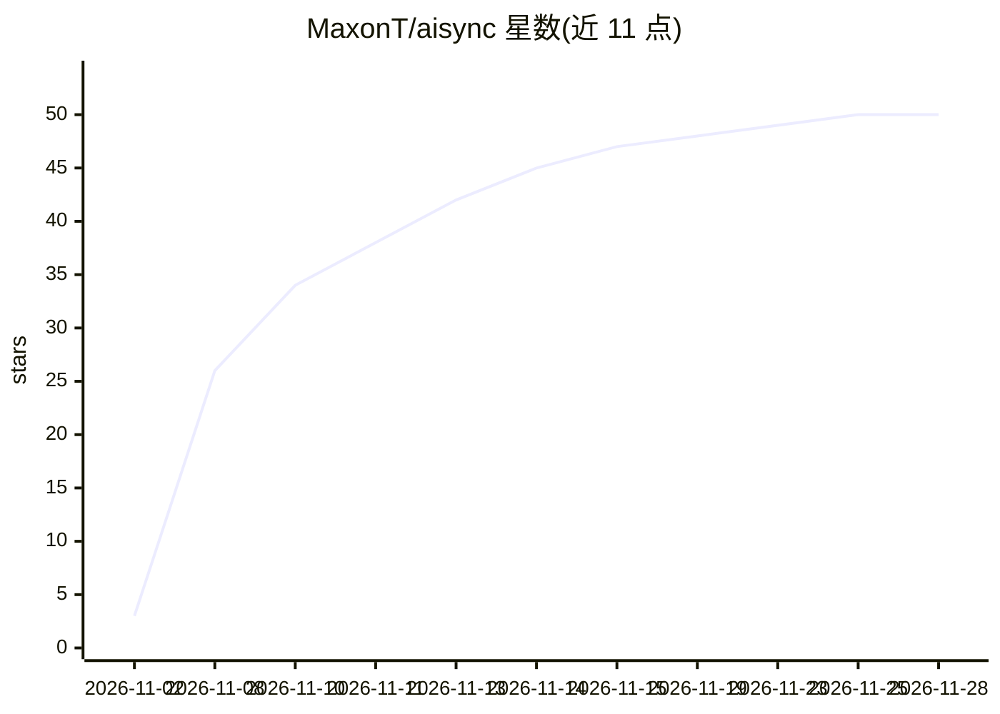

# MaxonT/aisync

⭐ 50 · Python · MIT · 推送 2026-11-26 · [GitHub](https://github.com/MaxonT/aisync) · [官网](https://maxont.github.io/aisync/) · 个人维护 · 中文 README

**多 AI 编程 agent 的本地共享上下文、协调与可观测中心**

面向同时运行多个 AI 编程 agent 的开发者：以 ~/.ai-sync/ 本地 git 仓库为中心，提供共享规则的 3-way 同步与分层按需注入、协作式文件声明（冲突返回 exit 3）、以及带哈希链的事件日志可用 aisync verify 校验篡改。对 Claude Code、Codex、Cursor 提供原生 hooks，其他 agent 可经 CLI、MCP server 或共享指令文件接入。限制：文件声明是协作式而非 OS 强制；校验不能发现删除日志末尾行的情况。核心仅用 Python 标准库，需 Python 3.11+ 与 git，支持 macOS/Linux。

## 筛选速览

| 维度 | 判定 | 备注 |
|---|---|---|
| AI 角色 | `ai-ecosystem` | LLM/agent 周边工具 |
| 许可风险 | `permissive` | MIT |
| 部署形态 | `self-host` | docker 或自建部署 |
| 模型依赖 | locked-api |  |
| 硬件要求 | — | 无带数字的原话,不猜 |
| 安装摩擦 | `low` | 无编译、无系统依赖或容器化 |
| 成熟度 | — | 结构信号不足 |

## 能力要点

- 共享规则 3-way 同步与分层加载，会话中按需注入
- 协作式文件声明与重叠检测（exit code 3）
- 哈希链事件日志，aisync verify 校验篡改
- 原生 hooks（Claude Code/Codex/Cursor）+ CLI/MCP/共享指令文件三种接入方式

## 适用场景

- 多个 AI 编程 agent 在同一仓库并发工作时避免文件冲突
- 在多个 agent 间共享规则与决策、阻塞记录
- 审计 agent 活动并校验事件日志完整性

## 场景标签

`多智能体` `LLM 可观测性` · 领域:Agent 开发

## 证据(README 行号)

> L7: aisync is **agent-agnostic at its core**. It provides native hooks for Claude Code, Codex and Cursor, and exposes it
> L40: Developers running **two or more AI coding agents** across one or multiple repositories—especially when agents work
> L54: |**Native hooks**|Claude Code, Codex, Cursor|Automatic context and news delivery at supported hook events, plus acc

## 星数曲线

2026-11-02 3 → 2026-11-28 50（+47）

---
*卡片 v1 · prompt 1.4 · 生成 2026-11-18 · 置信度 high · 依据 README sha `c7e5a484685f` · [字段定义](../../DATASET.md)*
