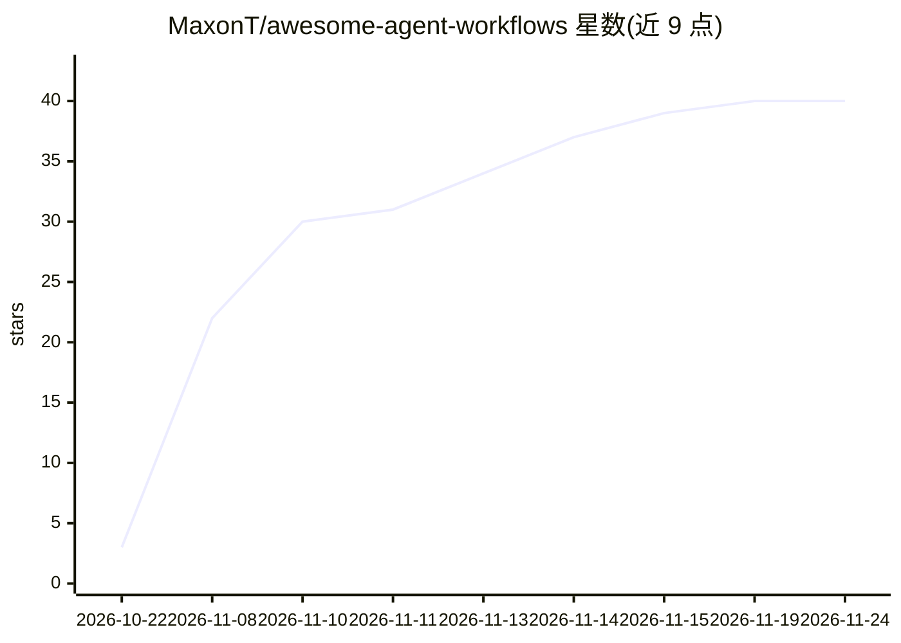

# MaxonT/awesome-agent-workflows

⭐ 40 · HTML · CC0-1.0 · 推送 2026-11-16 · [GitHub](https://github.com/MaxonT/awesome-agent-workflows) · 个人维护 · 中文 README

**按星标排名的 AI agent 框架与工作流项目清单（中英双语）**

从 GitHub 收集知名 agent、harness 与 workflow 项目，去重、链接校验后按 star 数排名，分 Top Picks、Coding Agents & Harnesses、Agent Frameworks、Workflow Platforms、Patterns & Guides 五大类组织，每条含星数、语言、更新时间与描述。中英双语呈现，由程序定时自动再生成以保持数据新鲜。面向需要选型或了解 agent 生态的开发者，本身不提供安装或运行方式。

## 筛选速览

| 维度 | 判定 | 备注 |
|---|---|---|
| AI 角色 | `ai-knowledge` | 知识聚合/清单类 |
| 许可风险 | `viral` | CC0-1.0 |
| 部署形态 | `None` |  |
| 模型依赖 | — | README 未给出锁定关系 |
| 硬件要求 | — | 无带数字的原话,不猜 |
| 安装摩擦 | `low` | 无编译、无系统依赖或容器化 |
| 成熟度 | — | 结构信号不足 |

## 能力要点

- 五大类别组织条目并按 star 排名
- 去重与链接校验的自动化收集流程
- 定时自动重新生成保持数据新鲜
- 中英双语列表与交互式版本

## 适用场景

- 挑选 AI agent 框架或工作流平台时按星标浏览候选
- 了解 coding agent 与 harness 生态的项目分布
- 查找 agent 设计模式与学习资源

## 场景标签

`精选清单` · 领域:学习与行业

## 证据(README 行号)

> L5:  Well-known agent, harness and workflow projects on GitHub, ranked by stars
> L123: This list is collected from GitHub, deduplicated, link-checked and ranked by stars (recency breaks ties). It is re

## 星数曲线

2026-10-22 3 → 2026-11-24 40（+37）

---
*卡片 v1 · prompt 1.4 · 生成 2026-11-18 · 置信度 high · 依据 README sha `e5b8f888104a` · [字段定义](../../DATASET.md)*
