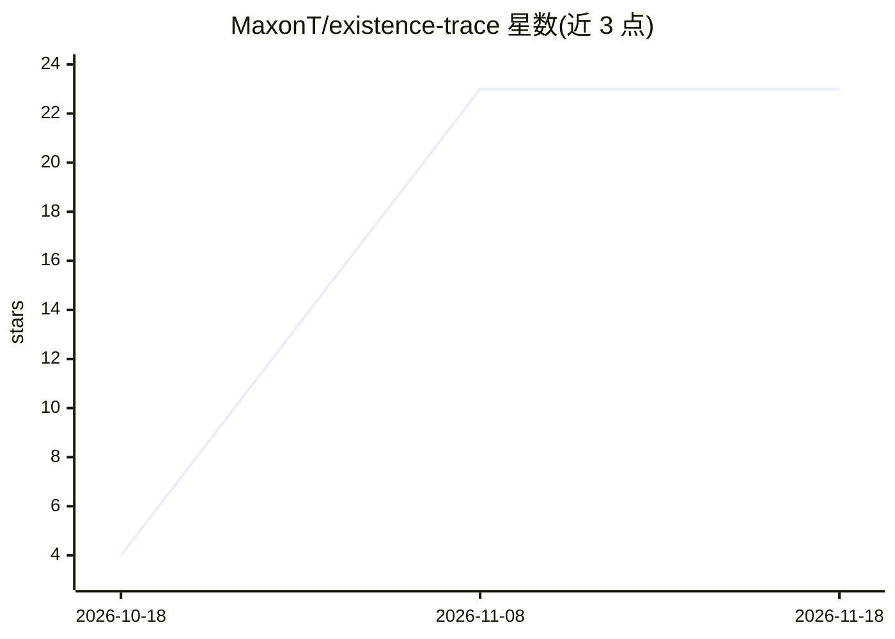

# MaxonT/existence-trace

⭐ 23 · Python · MIT · 推送 2026-11-16 · [GitHub](https://github.com/MaxonT/existence-trace) · [官网](https://maxont.github.io/existence-trace/) · 个人维护 · 中文 README

**AI 读取个人日记并生成规则的个人状态系统**

命令行工具：AI 每天读取用户 Markdown 日记，通过 PAD 情绪、稳定与探索（G）、成长（XP）三个视角生成报告；对不确定之处向用户提问，回答变成规则，规则被实际使用时记录前后对比回执，每周审计校验。支持导入旧日记（.md/.txt/Day One），可接入 Anthropic、OpenAI、DeepSeek、OpenRouter、Ollama 或任意 OpenAI 兼容端点。数据为用户自有文件夹中的纯文本，仅用 Python 标准库。声明 PAD/G/XP 非临床量表。

## 筛选速览

| 维度 | 判定 | 备注 |
|---|---|---|
| AI 角色 | `ai-native` | 本体是模型或模型工具 |
| 许可风险 | `permissive` | MIT |
| 部署形态 | `self-host` | docker 或自建部署 |
| 模型依赖 | local-ok | 支持本地模型 |
| 硬件要求 | — | 无带数字的原话,不猜 |
| 安装摩擦 | `low` | 无编译、无系统依赖或容器化 |
| 成熟度 | — | 结构信号不足 |

## 能力要点

- PAD/G/XP 三视角日记分析与图表
- 提问→反馈→规则的自我改进闭环，附使用回执与每周审计
- 支持 DeepSeek/OpenRouter/Ollama 等多种 AI 端点及 OpenAI 兼容自定义地址
- 导入 .md/.txt/Day One 旧日记，原文逐字保留在受保护块中

## 适用场景

- 让 AI 每天阅读我的日记并生成情绪与成长报告
- 把多年旧日记导入并交给 AI 处理
- 把对 AI 的偏好反馈沉淀为可审计的规则

## 场景标签

`知识库管理` · 领域:知识与检索

## 证据(README 行号)

> L7:  An AI that reads your journal every day, asks you where it is unsure, turns your answers into rules, and has to pro
> L30: - **It reads.** Each day it writes a report through three lenses: emotion (PAD), stability and exploration (G), gro

## 星数曲线

2026-10-18 4 → 2026-11-18 23（+19）

---
*卡片 v1 · prompt 1.4 · 生成 2026-11-18 · 置信度 high · 依据 README sha `0435c93b75b7` · [字段定义](../../DATASET.md)*
