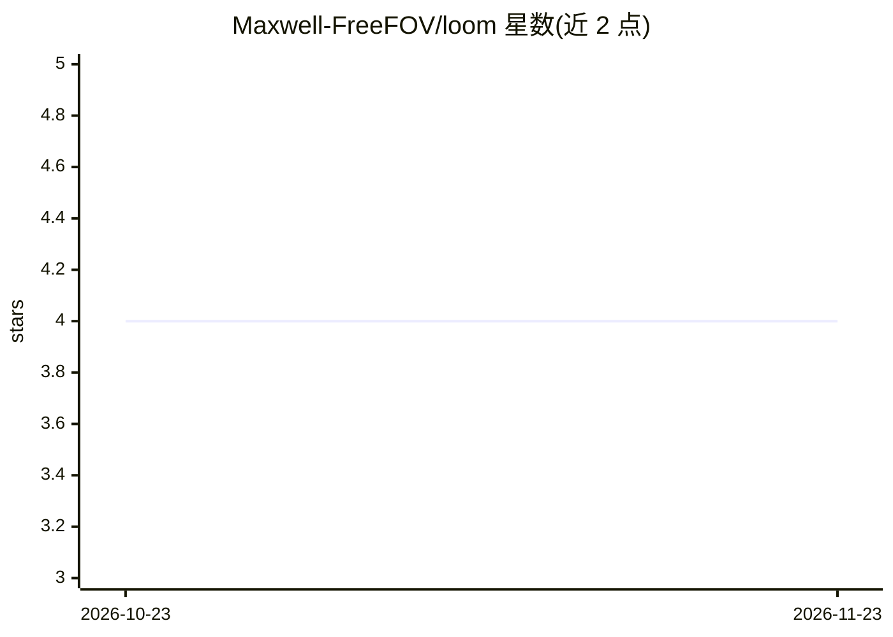

# Maxwell-FreeFOV/loom

⭐ 4 · Python · MIT · 推送 2026-11-01 · [GitHub](https://github.com/Maxwell-FreeFOV/loom) · [官网](https://github.com/Maxwell-FreeFOV/loom/tree/main/examples/reading-notes/en) · 个人维护 · 中文 README

**给 AI 助手用的项目记忆技能：决策、事实、下一步存为 Markdown**

Loom 是一个面向 AI 编程助手的 Agent Skill，把长期项目中的对话与讨论整理为项目文件夹内的结构化 Markdown 知识库：决策记录（含理由、反对论点、置信度、复审日期）、带来源引用的知识页，以及新会话优先读取的 hot.md 状态页；每次归档由 AI 做一次 git 提交，无数据库、无后台服务。通过 init/wrapup/ingest/publish/lint 等操作运行，支持 Claude Code、Codex、Gemini CLI 等工具。限制：需用户主动发起归档，每次会话携带额外上下文，搜索仅限索引页与文件搜索，无语义检索。

## 筛选速览

| 维度 | 判定 | 备注 |
|---|---|---|
| AI 角色 | `ai-native` | 本体是模型或模型工具 |
| 许可风险 | `permissive` | MIT |
| 部署形态 | `library` | 以包/库形式分发 |
| 模型依赖 | — | README 未给出锁定关系 |
| 硬件要求 | — | 无带数字的原话,不猜 |
| 安装摩擦 | `low` | 无编译、无系统依赖或容器化 |
| 成熟度 | — | 结构信号不足 |

## 能力要点

- 决策记录含选项、理由、反对论点、置信度与复审日期
- 知识页中每条声明标注来源，源文件保持不变
- 归档操作自动生成会话笔记并做一次 git 提交
- publish 可生成受限快照分享，会话与决策记录不外带

## 适用场景

- 跨数周或数月的多会话项目，让 AI 在新会话中接续上下文
- 记录并追溯技术决策的备选方案与理由
- 研究型工作需要为每个结论标注来源出处
- 把项目记录迁移到另一个 AI 工具或交接给他人

## 场景标签

`知识库管理` `Agent 记忆` · 领域:Agent 开发

## 证据(README 行号)

> L7: **Loom helps your AI assistant keep the record of a long project: what you decided, why you decided it, where each f
> L11: Loom is a skill for AI assistants. The AI writes the project record into Markdown files in your project folder. Eac
> L117: - It links the skill into the skills folders of the tools it finds. The default tools are Claude Code and Codex. U

## 星数曲线

2026-10-23 4 → 2026-11-23 4（+0）

---
*卡片 v1 · prompt 1.4 · 生成 2026-11-21 · 置信度 high · 依据 README sha `fd01016882a8` · [字段定义](../../DATASET.md)*
