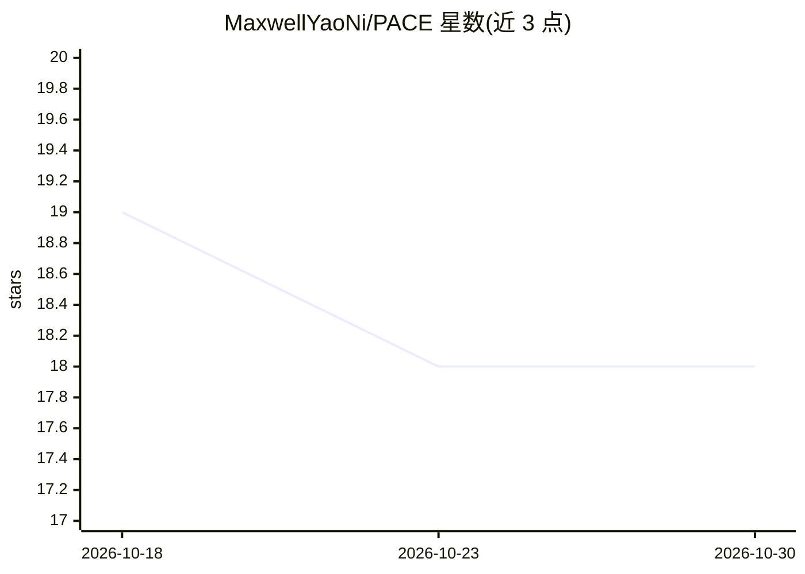

# MaxwellYaoNi/PACE

⭐ 18 · Python · MIT · 推送 2026-06-05 · [GitHub](https://github.com/MaxwellYaoNi/PACE) · 个人维护

**NeurIPS 2024 论文 PACE 的官方代码：PEFT 一致性正则化方法**

PACE（PArameter-efficient fine-tuning with Consistency rEgularization）的官方实现，NeurIPS 2024 Spotlight 论文，作者来自澳大利亚国立大学（Yao Ni、Shan Zhang、Piotr Koniusz）。方法通过扰动间的一致性正则化降低梯度范数、对 adapter 特征施加一致性以保留预训练知识，从而提升泛化。README 声明在 VTAB-1K 与 Few-Shot Learning 上的代码已发布，但页面未给出具体安装或运行命令；提供 arXiv 论文、幻灯片、海报与视频链接。

## 筛选速览

| 维度 | 判定 | 备注 |
|---|---|---|
| AI 角色 | `ai-native` | 本体是模型或模型工具 |
| 许可风险 | `permissive` | MIT |
| 部署形态 | `None` |  |
| 模型依赖 | — | README 未给出锁定关系 |
| 硬件要求 | — | 无带数字的原话,不猜 |
| 安装摩擦 | `low` | 无编译、无系统依赖或容器化 |
| 成熟度 | — | 结构信号不足 |

## 能力要点

- 参数高效微调（PEFT）结合一致性正则化的官方实现
- 已在 VTAB-1K 与 Few-Shot Learning 任务上发布代码
- 提供 arXiv 论文、幻灯片、海报与视频讲解

## 适用场景

- 复现论文中的 VTAB-1K 与少样本学习实验
- 研究生如何用一致性正则化提升 PEFT 泛化
- 在视觉 Transformer 微调中借鉴其正则化方法

## 场景标签

`微调` · 领域:训练与推理

## 证据(README 行号)

> L1: PACE: Marrying generalization in PArameter-efficient fine-tuning with Consistency rEgularization (NeurIPS 2024 Spotl
> L29: ## Code for PACE on VTAB-1K and Few-Shot Learning is Released.

## 星数曲线

2026-10-18 19 → 2026-10-30 18（-1）

---
*卡片 v1 · prompt 1.4 · 生成 2026-10-29 · 置信度 mid · 依据 README sha `27eacbc9721e` · [字段定义](../../DATASET.md)*
