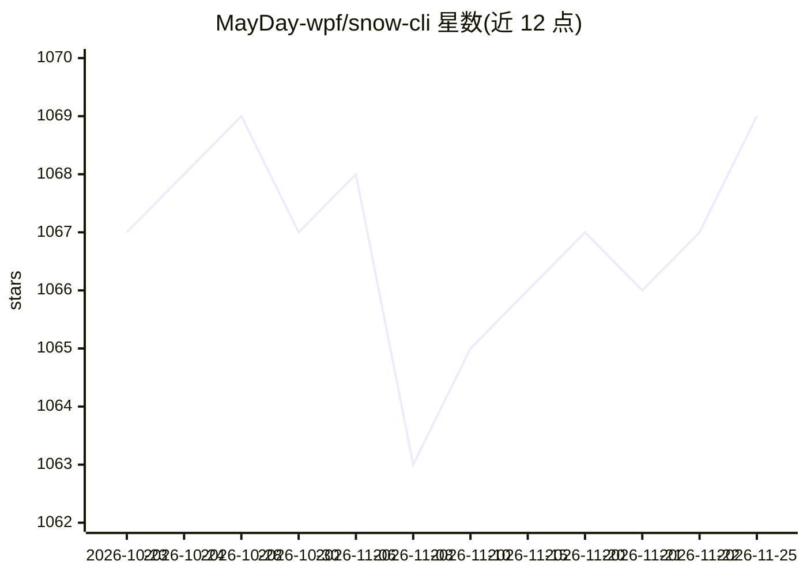

# MayDay-wpf/snow-cli

⭐ 1,069 · TypeScript · NOASSERTION · 推送 2026-11-19 · [GitHub](https://github.com/MayDay-wpf/snow-cli) · 个人维护 · 中文 README

**终端里的 AI 编程智能体 CLI，兼容多家模型接口**

以 Node.js/npm 包形式发布的终端编程智能体：通过命令 `snow` 启动对话式编程会话，兼容 OpenAI、Gemini、Claude 与 Deepseek 等模型接口，支持第三方中转配置。功能覆盖子智能体、MCP 服务管理、LSP 集成、Skills 命令、异步后台任务、无头模式与 SSE 服务模式、多智能体团队协作、漏洞挖掘模式、钩子与主题自定义，并提供 VSCode 扩展与 JetBrains 插件。要求 Node.js >= 18.x，运行后在 `~/.snow/` 创建用户配置目录。

## 筛选速览

| 维度 | 判定 | 备注 |
|---|---|---|
| AI 角色 | `ai-ecosystem` | LLM/agent 周边工具 |
| 许可风险 | `none` | NOASSERTION |
| 部署形态 | `library` | 以包/库形式分发 |
| 模型依赖 | — | README 未给出锁定关系 |
| 硬件要求 | — | 无带数字的原话,不猜 |
| 安装摩擦 | `low` | 无编译、无系统依赖或容器化 |
| 成熟度 | — | 结构信号不足 |

## 能力要点

- 同时兼容 OpenAI、Gemini、Claude、Deepseek 等模型接口与第三方中转
- 支持子智能体、MCP、LSP、Skills、hooks 等扩展机制
- 提供无头模式、SSE 服务模式与异步任务管理
- 附带 VSCode 扩展与 JetBrains 插件

## 适用场景

- 在终端通过对话方式完成编码任务
- 配置第三方中转接入自选模型服务
- 用多智能体团队模式并行执行编程任务

## 场景标签

`编码 Agent` `多智能体` · 领域:Agent 开发

## 证据(README 行号)

> L18: _Agentic coding in your terminal_
> L65: Install Snow CLI globally via npm:
> L168: ├── api/                    # LLM API adapters

## 星数曲线

2026-10-23 1,067 → 2026-11-25 1,069（+2）

---
*卡片 v1 · prompt 1.4 · 生成 2026-11-24 · 置信度 high · 依据 README sha `24206c21a2af` · [字段定义](../../DATASET.md)*
