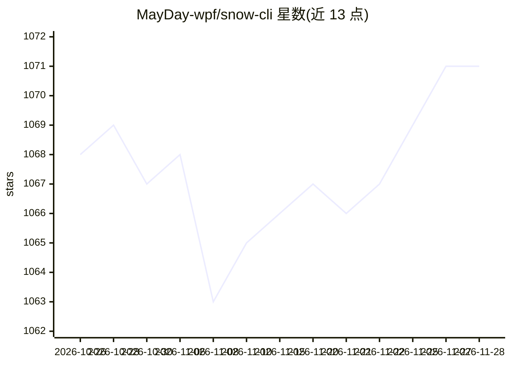

# MayDay-wpf/snow-cli

⭐ 1,071 · TypeScript · NOASSERTION · 推送 2026-11-27 · [GitHub](https://github.com/MayDay-wpf/snow-cli) · 个人维护 · 中文 README

**终端里的 AI 编程智能体 CLI，兼容多家模型服务商**

以 npm 包形式分发的终端 AI 编程智能体，用户在终端中通过对话让模型读写代码与执行任务。支持配置多家模型服务商的 API，提供子代理、团队模式多智能体协作、异步后台任务、headless 模式、MCP 服务接入、LSP 集成、hooks 自动化、命令注入与敏感命令保护、漏洞挖掘模式等机制；配套 VSCode 扩展与 JetBrains 插件，另有独立的桌面客户端 Snow App。运行需 Node.js >= 18.x。

## 筛选速览

| 维度 | 判定 | 备注 |
|---|---|---|
| AI 角色 | `ai-native` | 本体是模型或模型工具 |
| 许可风险 | `none` | NOASSERTION |
| 部署形态 | `library` | 以包/库形式分发 |
| 模型依赖 | locked-api |  |
| 硬件要求 | — | 无带数字的原话,不猜 |
| 安装摩擦 | `low` | 无编译、无系统依赖或容器化 |
| 成熟度 | — | 结构信号不足 |

## 能力要点

- 同时适配 OpenAI、Gemini、Claude、DeepSeek 等模型 API
- 多智能体协作（子代理/团队模式）与异步后台任务管理
- MCP 服务管理与 LSP 集成
- 提供 VSCode 扩展与 JetBrains 插件

## 适用场景

- 在终端中让 AI 智能体直接修改本地代码库
- 用 headless 模式把对话集成到脚本与第三方工具
- 配置多个子代理并行执行编程任务
- 接入 MCP 外部服务扩展智能体能力

## 场景标签

`编码 Agent` `多智能体` · 领域:Agent 开发

## 证据(README 行号)

> L18: _Agentic coding in your terminal_
> L63: ## Installation
> L68: npm install -g snow-ai

## 星数曲线

2026-10-26 1,068 → 2026-11-28 1,071（+3）

---
*卡片 v1 · prompt 1.4 · 生成 2026-11-28 · 置信度 high · 依据 README sha `6cae459f3a0c` · [字段定义](../../DATASET.md)*
