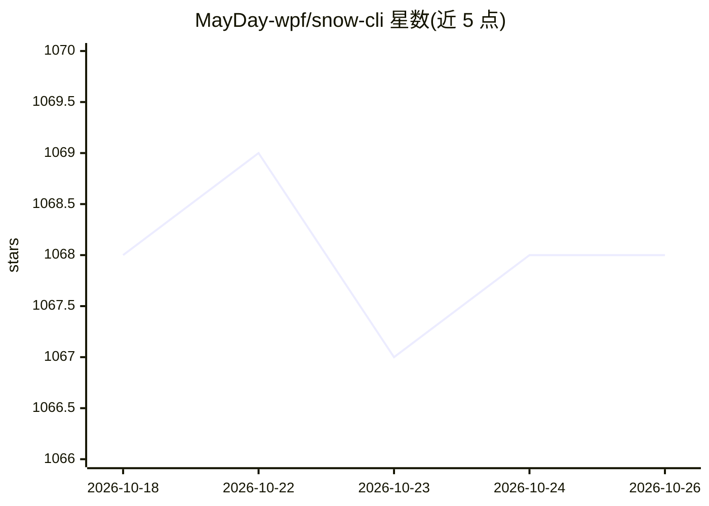

# MayDay-wpf/snow-cli

⭐ 1,068 · TypeScript · NOASSERTION · 推送 2026-10-23 · [GitHub](https://github.com/MayDay-wpf/snow-cli) · 个人维护 · 中文 README

**终端 AI 编程智能体 CLI，兼容多家 LLM 提供商**

运行在终端的 npm 全局安装式 AI 编程智能体（snow-ai），描述为同时兼容 OpenAI、Gemini、Claude 等模型。功能覆盖命令面板、子 Agent、敏感命令保护、Hooks、MCP 服务配置、异步任务、漏洞挖掘模式、LSP 集成、SSE 服务模式、团队多 Agent 协作与隐私过滤等，并兼容 Claude Code Skills 与中继站配置。需 Node.js >= 18.x，提供 VSCode 扩展与 JetBrains 插件源码，另有桌面客户端 Snow App（独立仓库）。文档中英双语。

## 筛选速览

| 维度 | 判定 | 备注 |
|---|---|---|
| AI 角色 | `ai-native` | 本体是模型或模型工具 |
| 许可风险 | `none` | NOASSERTION |
| 部署形态 | `library` | 以包/库形式分发 |
| 模型依赖 | — | README 未给出锁定关系 |
| 硬件要求 | — | 无带数字的原话,不猜 |
| 安装摩擦 | `low` | 无编译、无系统依赖或容器化 |
| 成熟度 | — | 结构信号不足 |

## 能力要点

- 终端内 agentic coding，npm 全局安装后以 snow 命令启动
- 兼容 OpenAI、Gemini、Claude 等多家 LLM 与第三方中继配置
- 支持 MCP、LSP、Hooks、异步任务、团队多 Agent 协作、SSE 服务模式
- 兼容 Claude Code Skills，提供 VSCode 扩展与 JetBrains 插件源码

## 适用场景

- 在终端里通过 AI 智能体完成编程任务
- 配置多家模型提供商或中继站按需切换
- 用 Headless/SSE 模式集成到脚本和第三方工具

## 场景标签

`编码 Agent` `多智能体` · 领域:Agent 开发

## 证据(README 行号)

> L18: _Agentic coding in your terminal_
> L65: Install Snow CLI globally via npm:
> L68: npm install -g snow-ai

## 星数曲线

2026-10-18 1,068 → 2026-10-26 1,068（+0）

---
*卡片 v1 · prompt 1.4 · 生成 2026-10-21 · 置信度 high · 依据 README sha `3f9fb77400d5` · [字段定义](../../DATASET.md)*
