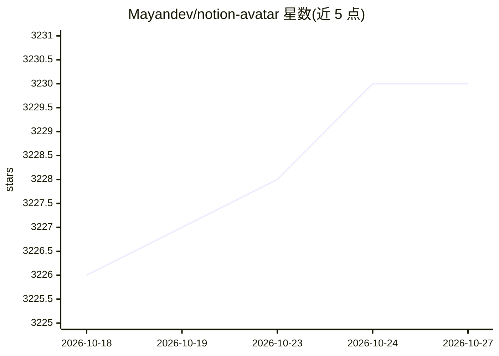

# Mayandev/notion-avatar

⭐ 3,230 · TypeScript · MIT · 推送 2026-06-06 · [GitHub](https://github.com/Mayandev/notion-avatar) · [官网](https://notion-avatar.app) · 个人维护 · 中文 README

**在线生成 Notion 风格头像的工具，支持照片转换与文字描述生成**

基于 Next.js 的在线头像生成工具，提供两类 AI 功能：将用户照片转换为 Notion 风格头像、根据文字描述生成头像。素材库含 16 种脸型、58 种发型等 10 类部件可组合，素材来自 Noto avatar 插画包，按 CC0 许可使用。界面支持英/简中/繁中/韩/日/西/法/德/葡/俄 10 种语言。README 未给出安装或部署命令。

## 筛选速览

| 维度 | 判定 | 备注 |
|---|---|---|
| AI 角色 | `ai-native` | 本体是模型或模型工具 |
| 许可风险 | `permissive` | MIT |
| 部署形态 | `None` |  |
| 模型依赖 | — | README 未给出锁定关系 |
| 硬件要求 | — | 无带数字的原话,不猜 |
| 安装摩擦 | `low` | 无编译、无系统依赖或容器化 |
| 成熟度 | — | 结构信号不足 |

## 能力要点

- 照片转 Notion 风格头像的 AI 功能
- 根据文字描述生成头像
- 10 类共约 195 个部件素材（CC0 许可）
- 支持 10 种界面语言

## 适用场景

- 把个人照片转成 Notion 风格头像
- 通过文字描述生成个性化头像
- 手动组合五官部件制作头像

## 场景标签

`图像生成` `图像视频处理` · 领域:内容生成

## 证据(README 行号)

> L5: AI-powered online tool for making notion-style avatars.
> L20: - Transform your photos into Notion-style avatars

## 星数曲线

2026-10-18 3,226 → 2026-10-27 3,230（+4）

---
*卡片 v1 · prompt 1.4 · 生成 2026-10-21 · 置信度 high · 依据 README sha `bd9871953fa4` · [字段定义](../../DATASET.md)*
