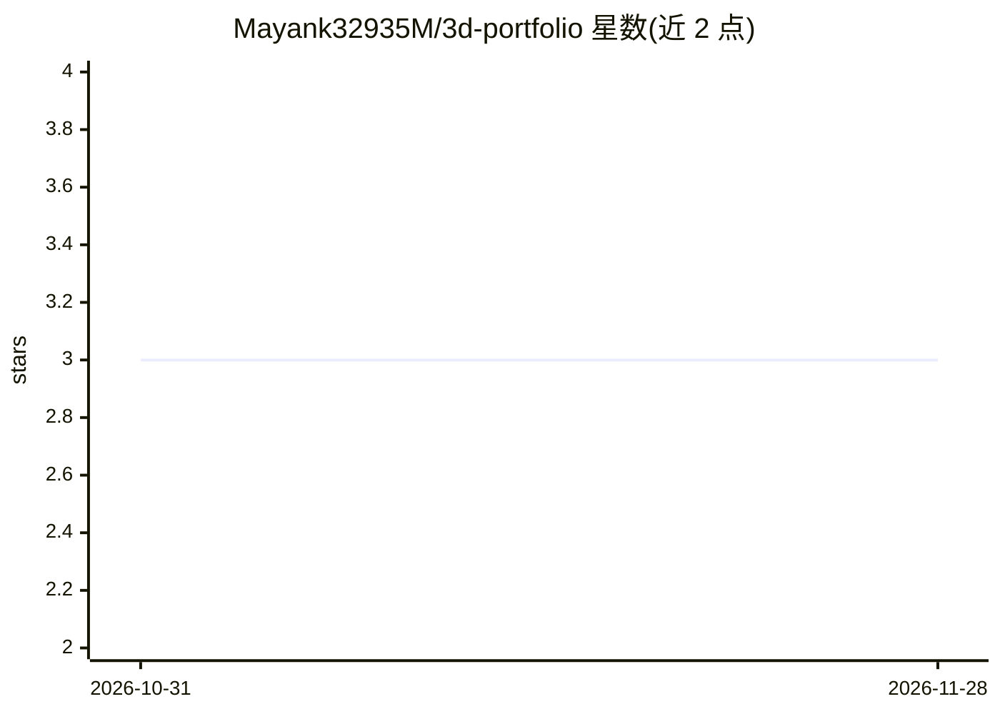

# Mayank32935M/3d-portfolio

⭐ 3 · TypeScript · MIT · 推送 2026-10-25 · [GitHub](https://github.com/Mayank32935M/3d-portfolio) · [官网](https://mayankdabas.me) · 个人维护

**AI/ML 学生的交互式 3D 开发者作品集网站**

基于 Next.js 16、Three.js、React 19 与 Tailwind CSS 构建的个人 3D 作品集网站：包含程序化生成的 30 键 3D 机械键盘（按键展示简历技能）、项目展示区、可涂鸦的 PDF 简历画布、基于 Socket.io 的实时多人光标与聊天功能，以及 GSAP/Framer Motion 动效和明暗主题切换。面向访客展示作者的项目与技能。安装需 Node.js 20.9+ 与 pnpm，联系表单需配置 Resend API key。

## 筛选速览

| 维度 | 判定 | 备注 |
|---|---|---|
| AI 角色 | `ai-enhanced` | 去掉 AI 部分产品仍成立 |
| 许可风险 | `permissive` | MIT |
| 部署形态 | `library` | 以包/库形式分发 |
| 模型依赖 | — | README 未给出锁定关系 |
| 硬件要求 | — | 无带数字的原话,不猜 |
| 安装摩擦 | `low` | 无编译、无系统依赖或容器化 |
| 成熟度 | — | 结构信号不足 |

## 能力要点

- 程序化生成的 30 键 3D 机械键盘，按键触发 3D 文字描述
- /resume 路径的交互式 PDF 涂鸦简历（画笔/橡皮/颜色控制）
- Socket.io 实时多人光标追踪、在线检测与访客聊天
- 展示 FORENSIC-X、Suraksha Sense 等多个项目条目

## 适用场景

- 浏览这位 AI/ML 学生的项目经历与技能
- 在 3D 页面上互动涂鸦其简历 PDF
- 参考 3D 作品集的技术实现（Next.js + Three.js）

## 场景标签

 · 领域:个人网站/作品集

## 证据(README 行号)

> L3: **An interactive 3D developer portfolio showcasing verifiable systems, applied AI, and full-stack engineering.** Pre
> L26: |**Core Framework**|Next.js 16.2.2 (Turbopack), React 19.2.4, TypeScript|
> L27: |**3D & Graphics**|@chibi3d/runtime, Three.js, React Three Fiber|

## 星数曲线

2026-10-31 3 → 2026-11-28 3（+0）

---
*卡片 v1 · prompt 1.4 · 生成 2026-11-22 · 置信度 high · 依据 README sha `6b05926773a5` · [字段定义](../../DATASET.md)*
