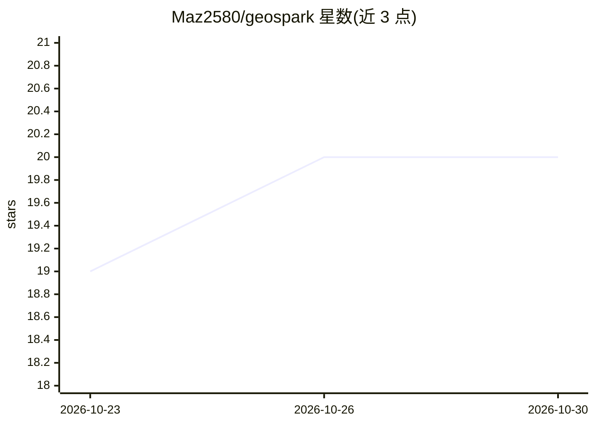

# Maz2580/geospark

⭐ 20 · Python · Apache-2.0 · 推送 2026-10-25 · [GitHub](https://github.com/Maz2580/geospark) · [官网](https://geospark.terrascout.app) · 个人维护

**给 LLM 提供可验证空间计算工具的 MCP 服务器与 Python 库**

GeoSpark 是一套空间推理工具服务：通过几何引擎（pyproj/Shapely/PROJ）与官方大地测量格网计算测地距离、拓扑、坐标基准与高程转换，供能调用工具的模型使用，而非由模型估算。提供 Python 库、CLI、REST API（59 个操作）、MCP 服务器（本地 25 个只读工具、托管 21 个）与网页界面。每个结果附带来源、许可、单位与警告，无法可靠计算时返回 cannot_answer 而非近似；并检查用户自有矢量/LiDAR/高程数据集的坐标系与高程错误。支持单服务器自托管（Valhalla 路由、Overpass OSM 副本、官方格网），Apache-2.0 许可。

## 筛选速览

| 维度 | 判定 | 备注 |
|---|---|---|
| AI 角色 | `ai-ecosystem` | LLM/agent 周边工具 |
| 许可风险 | `permissive` | Apache-2.0 |
| 部署形态 | `self-host` | docker 或自建部署 |
| 模型依赖 | — | README 未给出锁定关系 |
| 硬件要求 | — | 无带数字的原话,不猜 |
| 安装摩擦 | `low` | 无编译、无系统依赖或容器化 |
| 成熟度 | — | 结构信号不足 |

## 能力要点

- 测地距离、拓扑谓词、CRS 变换等由几何引擎计算，非模型估算
- 每个结果携带来源、许可、单位、警告与 ok/partial/cannot_answer 状态
- 提供 Python 库、CLI、REST API、MCP 服务器与网页五种接口
- 矢量/LiDAR/高程数据集的坐标系与高程基准错误检查

## 适用场景

- 为 Claude 等 MCP 客户端接入空间计算工具，获得带出处的地理答案
- 检查自有 GIS 数据集的 CRS、基准与高程引用错误
- 自托管一套无 API 成本的本地空间推理服务

## 场景标签

`数据分析` · 领域:效率与自动化

## 证据(README 行号)

> L11: GeoSpark provides language models with tools that **compute** spatial answers rather than estimate
> L88: |**Interfaces**|Python library, command-line interface (`geospark …`), REST API (59 documented operations, referenc
> L107: **Hosted MCP server.** In Claude or any MCP client, add a custom connector with the following URL

## 星数曲线

2026-10-23 19 → 2026-10-30 20（+1）

---
*卡片 v1 · prompt 1.4 · 生成 2026-10-28 · 置信度 high · 依据 README sha `aab5ebb78bc6` · [字段定义](../../DATASET.md)*
