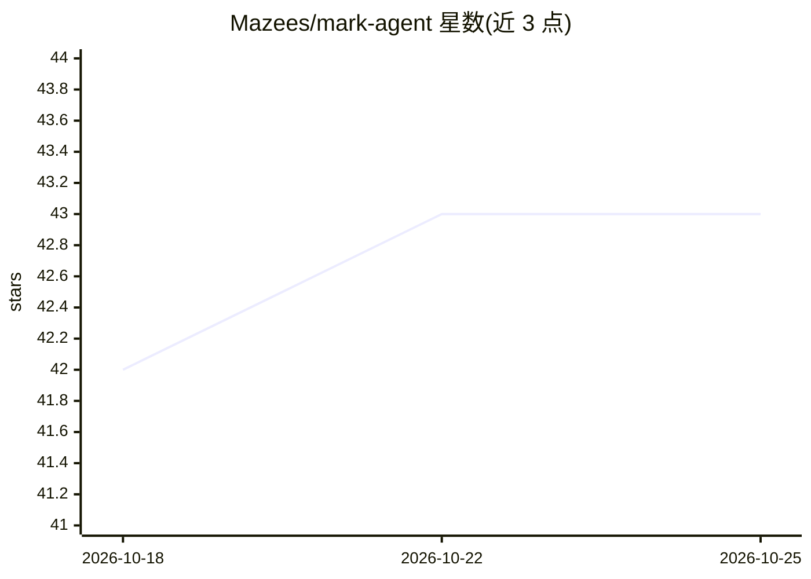

# Mazees/mark-agent

⭐ 43 · JavaScript · AGPL-3.0 · 推送 2026-10-24 · [GitHub](https://github.com/Mazees/mark-agent) · 个人维护

**Windows 本地运行的个人 AI 助理，带长期记忆与多 Agent 系统**

面向个人用户的本地 AI 助理应用：Node.js Core + React 19 / Vite 7 WebUI，优化于 Windows 10/11 64-bit。提供基于 SQLite 与本地 384 维 embedding 的长期向量记忆（episodic/semantic/core memory）、ReAct 式任务规划、多 Sub-Agent 引擎、浏览器/桌面自动化（Windows UIAutomation + C# daemon）、Google Workspace 与 Telegram 集成、离线 RAG 与本地 Whisper 语音交互。AI 后端可选内置 Gemini、DeepSeek、LM Studio 本地或 Cloud API（Groq/Cerebras）。

## 筛选速览

| 维度 | 判定 | 备注 |
|---|---|---|
| AI 角色 | `ai-native` | 本体是模型或模型工具 |
| 许可风险 | `viral` | AGPL-3.0 |
| 部署形态 | `library` | 以包/库形式分发 |
| 模型依赖 | — | README 未给出锁定关系 |
| 硬件要求 | — | 无带数字的原话,不猜 |
| 安装摩擦 | `low` | 无编译、无系统依赖或容器化 |
| 成熟度 | — | 结构信号不足 |

## 能力要点

- SQLite 集中存储 + 本地 MiniLM embedding 的长期向量记忆体系
- 多 Sub-Agent 引擎与 ReAct 任务规划、持久化 checkpoint
- 离线 RAG 知识库（pdf/docx/txt/md）与 Memory Groomer 记忆合并
- Windows 桌面自动化、多会话浏览器自动化与 Telegram 远程控制

## 适用场景

- 在本地运行一个记住我习惯与偏好的个人 AI 助理
- 让 AI 代为操作桌面、浏览器和 Google Workspace 完成任务
- 通过 Telegram 远程控制 PC 上的助理并接收通知

## 场景标签

`AI 助手` `多智能体` `浏览器自动化` `GUI 自动化` · 领域:Agent 开发

## 证据(README 行号)

> L10: > **Mark BUKAN sekadar asisten virtual biasa. Mark adalah entitas AI yang dirancang untuk memiliki emosi, bertindak
> L36: - **Multi AI Provider (Built-in Gemini / DeepSeek / Local / Cloud):** Mark hadir dengan **Google Gemini Engine (Gra

## 星数曲线

2026-10-18 42 → 2026-10-25 43（+1）

---
*卡片 v1 · prompt 1.4 · 生成 2026-10-25 · 置信度 high · 依据 README sha `fbdf374433fc` · [字段定义](../../DATASET.md)*
