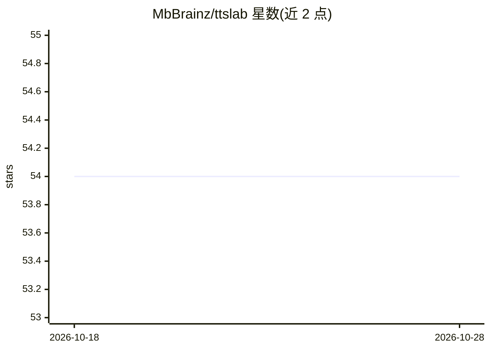

# MbBrainz/ttslab

⭐ 55 · TypeScript · MIT · 推送 2026-10-04 · [GitHub](https://github.com/MbBrainz/ttslab) · [官网](https://ttslab.dev) · 个人维护

**浏览器内测试与对比 TTS/STT 模型的网站，本地推理零上传**

基于 Next.js 16 的 Web 应用，通过 WebGPU 或 WASM 在用户浏览器内直接运行 TTS 与 STT 模型，支持多模型并排对比、模型目录浏览搜索与本地权重缓存；推理栈使用 ONNX Runtime Web、kokoro-js 与 @xenova/transformers，文本与音频不上传，无数据收集。面向想在本地零成本试用语音模型的开发者与用户，需在支持 WebGPU 的浏览器（Chrome/Edge 113+）中运行，通过 git clone 源码自行部署。

## 筛选速览

| 维度 | 判定 | 备注 |
|---|---|---|
| AI 角色 | `ai-native` | 本体是模型或模型工具 |
| 许可风险 | `permissive` | MIT |
| 部署形态 | `None` |  |
| 模型依赖 | — | README 未给出锁定关系 |
| 硬件要求 | — | 无带数字的原话,不猜 |
| 安装摩擦 | `low` | 无编译、无系统依赖或容器化 |
| 成熟度 | — | 结构信号不足 |

## 能力要点

- 模型经 WebGPU/WASM 完全在浏览器本地推理，零数据收集
- TTS 与 STT 模型并排对比测试
- 模型目录：浏览、搜索与投票
- 模型权重首次下载后本地缓存

## 适用场景

- 在本地浏览器试用和对比各类 TTS/STT 模型
- 为语音应用选型时并排比较多个模型的输出
- 在不上传文本与音频的前提下做语音生成与识别实验

## 场景标签

`语音合成` `语音识别` · 领域:内容生成

## 证据(README 行号)

> L3:  Test TTS & STT models in your browser. No server. No data collection. Powered by WebGPU.
> L12: - **In-browser inference** — models run entirely on your device via WebGPU or WASM
> L25: |Inference|ONNX Runtime Web, kokoro-js, @xenova/transformers|

## 星数曲线

2026-10-18 54 → 2026-10-28 54（+0）

---
*卡片 v1 · prompt 1.4 · 生成 2026-10-24 · 置信度 high · 依据 README sha `d16d0185e43b` · [字段定义](../../DATASET.md)*
