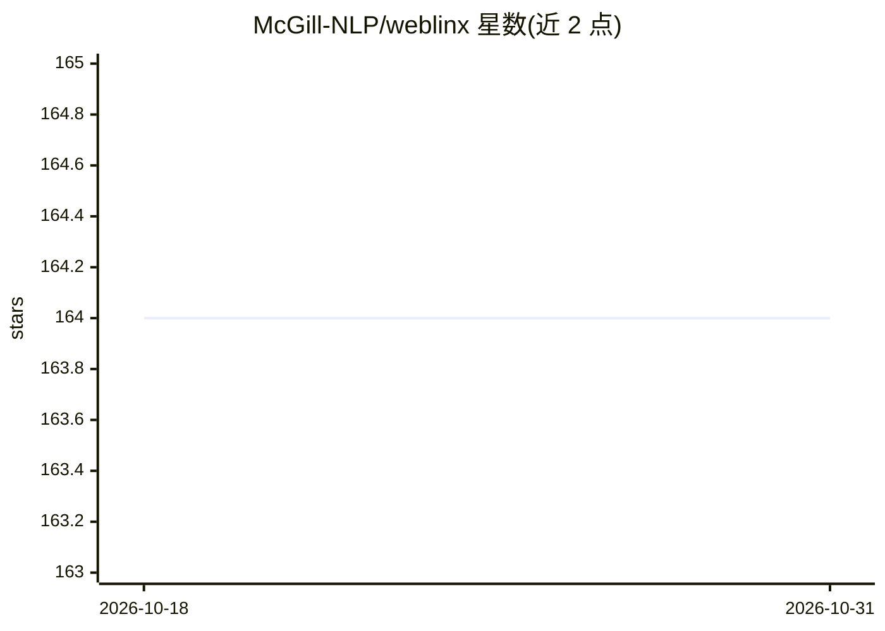

# McGill-NLP/weblinx

⭐ 164 · Python · Apache-2.0 · 推送 2026-08-16 · [GitHub](https://github.com/McGill-NLP/weblinx) · [官网](https://mcgill-nlp.github.io/weblinx) · 组织维护

**网页导航 agent 基准数据集及配套 Python 库**

McGill-NLP 发布的 ICML 2024 论文配套项目：提供 WebLINX 真实网站多轮对话导航演示数据集，以及用于数据处理与评测的 Python 库（Demonstration/Replay/Turn 抽象、weblinx.eval 命令行评测）。另含 modeling/ 目录，用于训练与评测论文报告的模型（DMR、LLaMA、MindAct、Pix2Act、Flan-T5）。已通过 weblinx-browsergym 扩展接入 BrowserGym，发布 WebLINX 1.1 数据集，支持 Agentlab 代理运行。

## 筛选速览

| 维度 | 判定 | 备注 |
|---|---|---|
| AI 角色 | `ai-knowledge` | 知识聚合/清单类 |
| 许可风险 | `permissive` | Apache-2.0 |
| 部署形态 | `library` | 以包/库形式分发 |
| 模型依赖 | — | README 未给出锁定关系 |
| 硬件要求 | — | 无带数字的原话,不猜 |
| 安装摩擦 | `low` | 无编译、无系统依赖或容器化 |
| 成熟度 | — | 结构信号不足 |

## 能力要点

- 真实网站多轮对话导航演示数据集
- Python 库提供 Demonstration/Replay/Turn 数据处理抽象
- weblinx.eval 提供命令行自动评测
- 通过 weblinx-browsergym 扩展接入 BrowserGym 与 Agentlab

## 适用场景

- 用 WebLINX 数据集训练网页导航 agent 模型
- 对导航 agent 的动作输出做自动评测
- 在 BrowserGym/Agentlab 环境中运行与基准对比

## 场景标签

`模型评测` · 领域:评测与运维

## 证据(README 行号)

> L7: **WebLINX: Real-World Website Navigation with Multi-Turn Dialogue**\
> L19: Welcome to `WebLINX`'s official repository! In addition to providing code used to train the models reported in our 
> L50: |`weblinx.eval`|Code for evaluating action models trained with WebLINX, it has both `import`able functions/metrics,

## 星数曲线

2026-10-18 164 → 2026-10-31 164（+0）

---
*卡片 v1 · prompt 1.4 · 生成 2026-10-23 · 置信度 high · 依据 README sha `f104b4f5ded1` · [字段定义](../../DATASET.md)*
