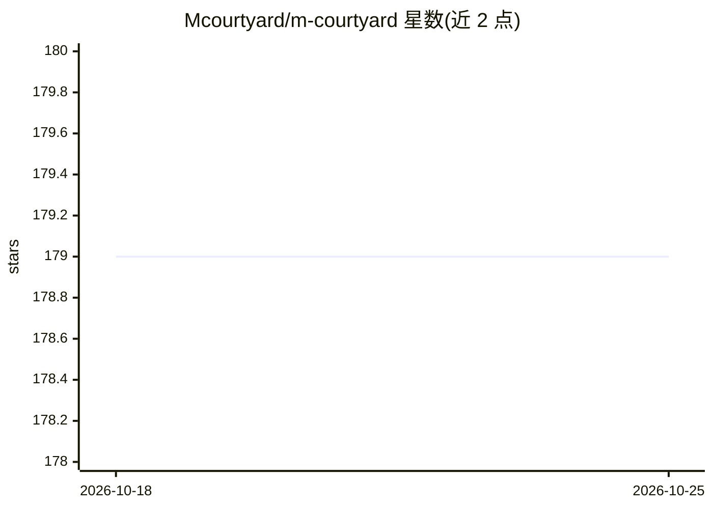

# Mcourtyard/m-courtyard

⭐ 180 · TypeScript · NOASSERTION · 推送 2026-07-11 · [GitHub](https://github.com/Mcourtyard/m-courtyard) · 个人维护 · 中文 README

**Apple Silicon 零代码本地 LLM 微调桌面应用**

面向 Apple Silicon Mac 用户的桌面应用（Tauri + React + mlx-lm），将 LLM 微调流程封装为图形界面：导入 PDF/DOCX/TXT 文档自动生成指令数据集，基于 MLX 执行 LoRA 微调（含预设配置与实时损失曲线），支持合并、量化（Q4/Q8/F16）后一键导出到 Ollama 或导出 MLX 模型供 LM Studio 使用。数据准备可用本地 Ollama/LM Studio 模型生成，也可走内置规则路径无需任何外部运行时。要求 macOS 14+、Apple Silicon、建议 16GB 内存；应用未签名需手动移除 quarantine 属性。

## 筛选速览

| 维度 | 判定 | 备注 |
|---|---|---|
| AI 角色 | `ai-ecosystem` | LLM/agent 周边工具 |
| 许可风险 | `none` | NOASSERTION |
| 部署形态 | `desktop` | 安装包/桌面程序 |
| 模型依赖 | local-ok | 支持本地模型 |
| 硬件要求 | — | 无带数字的原话,不猜 |
| 安装摩擦 | `medium` | 含编译或系统依赖之一 |
| 成熟度 | — | 结构信号不足 |

## 能力要点

- 从文档导入到数据集生成、LoRA 微调、导出的零代码流程
- 数据生成可用本地 Ollama/LM Studio 模型或内置规则（无需外部运行时）
- 一键合并量化并导出到 Ollama，或导出 MLX 模型供 LM Studio 加载
- 统一模型中心自动检测本地 HuggingFace/ModelScope/Ollama 资产

## 适用场景

- 在 Apple Silicon Mac 上不写代码微调本地 LLM
- 把企业或个人敏感文档转成训练数据并私有微调
- 微调后将模型导出到 Ollama 或 LM Studio 即时使用

## 场景标签

`微调` · 领域:训练与推理

## 证据(README 行号)

> L21: - **Zero-Code Pipeline**: From raw PDF/DOCX files to local datasets, MLX fine-tuning, and exportable local runtimes
> L56: - **`mlx-lm` is the core engine**: training and built-in inference are powered by Apple MLX rather than Ollama.

## 星数曲线

2026-10-18 179 → 2026-10-25 179（+0）

---
*卡片 v1 · prompt 1.4 · 生成 2026-10-22 · 置信度 high · 依据 README sha `4ee40ec97622` · [字段定义](../../DATASET.md)*
