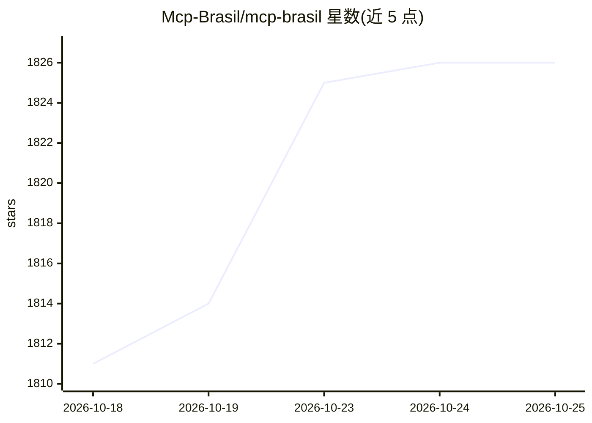

# Mcp-Brasil/mcp-brasil

⭐ 1,827 · Python · MIT · 推送 2026-09-19 · [GitHub](https://github.com/Mcp-Brasil/mcp-brasil) · 组织维护

**连接 AI agent 与巴西 70 个公共数据 API 的 MCP 服务器**

基于 FastMCP 的 Python MCP 服务器，将 533 个工具、131 个资源与 102 个提示词暴露给 Claude Desktop、Claude Code、Cursor、VS Code 等 MCP 客户端，覆盖经济、立法、透明度、司法、选举、健康等 15 个主题的巴西政府与公共数据 API。66 个 API 无需密钥，4 个可免费注册。提供跨 API 查询规划、并行批量执行、BM25 工具发现，以及通过环境变量启用的大数据集本地 DuckDB 缓存（含 TSE、ENEM 等，部分下载数百 MB 至 1.6GB）。项目独立于巴西政府，各数据源许可独立于代码的 MIT 许可。

## 筛选速览

| 维度 | 判定 | 备注 |
|---|---|---|
| AI 角色 | `ai-ecosystem` | LLM/agent 周边工具 |
| 许可风险 | `permissive` | MIT |
| 部署形态 | `library` | 以包/库形式分发 |
| 模型依赖 | locked-api |  |
| 硬件要求 | — | 无带数字的原话,不猜 |
| 安装摩擦 | `low` | 无编译、无系统依赖或容器化 |
| 成熟度 | — | 结构信号不足 |

## 能力要点

- 533 个工具覆盖 70 个数据源、15 个主题领域
- 66 个 API 无需 API 密钥即可使用
- planejar_consulta 跨源查询规划与 executar_lote 并行批量执行
- 大数据集本地 DuckDB 缓存（如 SIAPA 81.3 万条房产、TSE 2014-2024）

## 适用场景

- 让 Claude 等客户端用自然语言查询巴西政府公开数据
- 交叉查询多名议员的支出、投票与提案
- 本地缓存分析 TSE 选举或 ENEM 教育微观数据

## 场景标签

`数据分析` · 领域:效率与自动化

## 证据(README 行号)

> L5: **MCP Server para 70 fontes de dados públicas brasileiras**
> L11: Conecte AI agents (Claude, GPT, Copilot, etc.) a dados governamentais do Brasil — economia, legislação, transparênc

## 星数曲线

2026-10-18 1,811 → 2026-10-25 1,826（+15）

---
*卡片 v1 · prompt 1.4 · 生成 2026-10-21 · 置信度 high · 依据 README sha `0ec0bce99ebb` · [字段定义](../../DATASET.md)*
