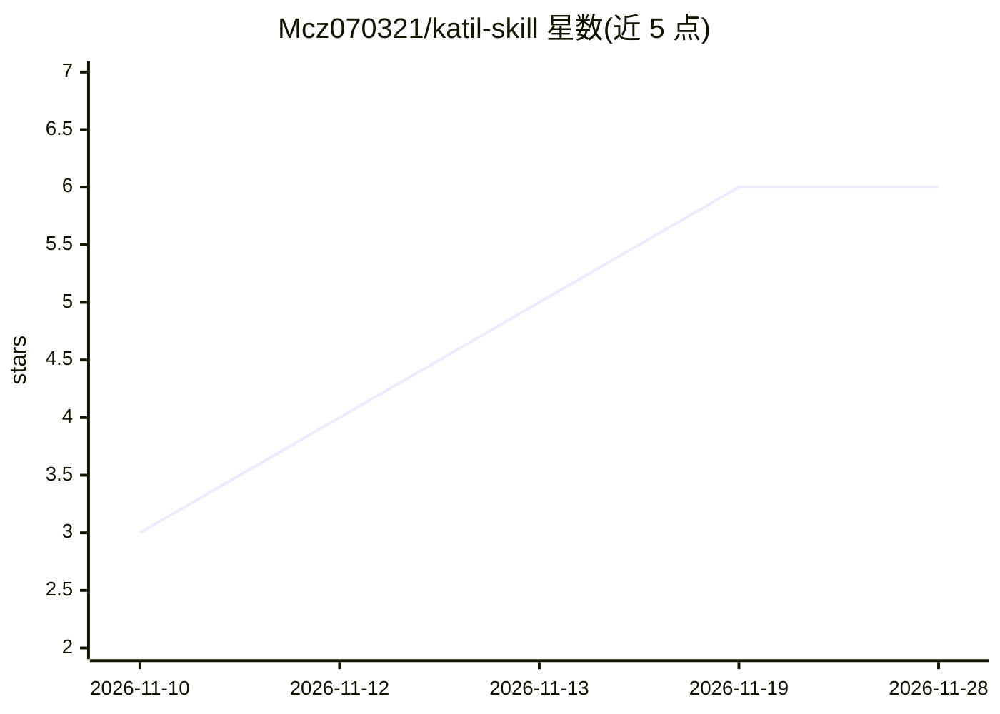

# Mcz070321/katil-skill

⭐ 6 · Python · MIT · 推送 2026-11-11 · [GitHub](https://github.com/Mcz070321/katil-skill) · 个人维护 · 中文 README

**给 AI 创作者的影视导演技能包：把需求变成双语视频提示词**

以 SKILL.md 为入口的 AI 影视导演技能包，面向把目录放入 Agent 技能目录（Claude Code 等）的用户。流程为：先立九维任务契约，再按决策域分配模块，输出中英双语、可直接粘贴进视频生成框的镜头提示词。内置 240 张能力卡与 60 张视觉风格配方的只读检索库（Python 脚本查询）、15 类特效的六层调度规则（FX Director 2.0）、EV0–EV3 证据分级与文字/视频分层验收。不生成视频、不绑定模型；默认平台无关，仅指定 Seedance 2.5 时加载适配。验证均为文本与结构层（EV1），无真实生成证据。

## 筛选速览

| 维度 | 判定 | 备注 |
|---|---|---|
| AI 角色 | `ai-knowledge` | 知识聚合/清单类 |
| 许可风险 | `permissive` | MIT |
| 部署形态 | `None` |  |
| 模型依赖 | — | README 未给出锁定关系 |
| 硬件要求 | — | 无带数字的原话,不猜 |
| 安装摩擦 | `low` | 无编译、无系统依赖或容器化 |
| 成熟度 | — | 结构信号不足 |

## 能力要点

- 240 张能力卡（C01–C24）与 60 张视觉风格配方，双语写法，脚本只读检索
- 15 类视觉特效按事件调度：主导 1 类＋辅助 0–3 类，三档预算（FX Director 2.0）
- EV0–EV3 证据分级，文字验收与视频验收分开记录
- 交付中英双语独立复制块，改动任一版本需同步另一版

## 适用场景

- 把一句模糊的创作需求变成可执行的分镜与视频提示词
- 为不同题材（动作/恐怖/广告/纪录片/动画）按同一决策流程做镜头设计
- 给视频模型撰写中英等义的提示词并逐项自检
- 用配套需求优化器先把零散想法整理成可执行指令

## 场景标签

`提示工程` `AI 写作` · 领域:Agent 开发

## 证据(README 行号)

> L23: KATIL-skill 是一个以 SKILL.md 为入口的 **AI 影视导演系统**。它把一句模糊的创作需求，变成一份可执行的镜头设计，再输出中英双语、可以直接粘贴进视频生成框的提示词。
> L80: ### 2. 安装到 Agent 的技能目录
> L82: 把整个目录放进运行时的 skills 路径，目录名保持 `katil-skill`：

## 星数曲线

2026-11-10 3 → 2026-11-28 6（+3）

---
*卡片 v1 · prompt 1.4 · 生成 2026-11-20 · 置信度 mid · 依据 README sha `f3785c2a21c2` · [字段定义](../../DATASET.md)*
