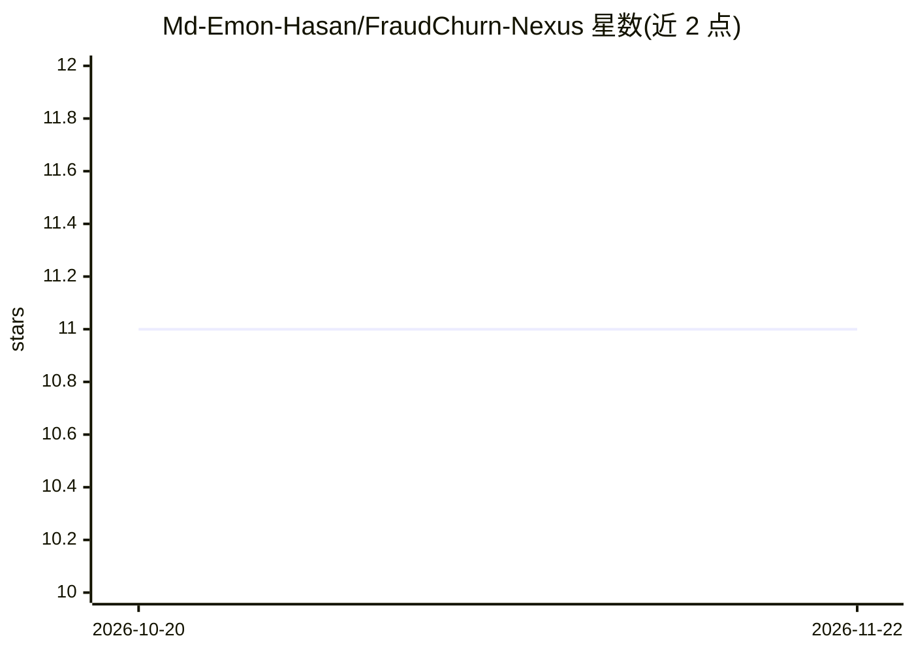

# Md-Emon-Hasan/FraudChurn-Nexus

⭐ 11 · Jupyter Notebook · 推送 2026-08-05 · [GitHub](https://github.com/Md-Emon-Hasan/FraudChurn-Nexus) · 个人维护

**为电商与电信风控团队提供统一 API 的欺诈与流失预测平台**

基于 FastAPI 与 scikit-learn 的单体应用：一个 API 后端服务两个独立训练的模型——逻辑回归欺诈检测流水线与五估算器硬投票流失预测集成，均以 pickle 工件在启动时加载；训练数据经 SMOTE 再平衡处理类别不平衡，请求与结果写入 SQLite 形成审计记录。前端为 React 19 + Vite + Tailwind/DaisyUI，表单下拉项取自训练数据元数据，附带 run.py 一键启动脚本、Docker Compose 部署与 pytest 测试套件。需 Python 3.10+ 与 Node.js 18+ 自行托管。

## 筛选速览

| 维度 | 判定 | 备注 |
|---|---|---|
| AI 角色 | `ai-native` | 本体是模型或模型工具 |
| 许可风险 | `none` | — |
| 部署形态 | `self-host` | docker 或自建部署 |
| 模型依赖 | — | README 未给出锁定关系 |
| 硬件要求 | — | 无带数字的原话,不猜 |
| 安装摩擦 | `low` | 无编译、无系统依赖或容器化 |
| 成熟度 | — | 结构信号不足 |

## 能力要点

- 统一 API 服务欺诈检测（逻辑回归，F1 0.90）与流失预测（五估算器硬投票集成）两个模型
- SMOTE 再平衡与自动特征工程预处理
- 每次预测写入 SQLite 持久审计日志
- run.py 一键启动、Docker Compose 部署与 CI 测试覆盖

## 适用场景

- 实时识别电商订单中的欺诈交易
- 预测电信客户流失风险并做主动挽留
- 为运营团队提供统一的风险监控面板
- 留存历史预测记录用于回测与合规审计

## 场景标签

 · 领域:金融/电商风控与客户分析

## 证据(README 行号)

> L17: Under the hood it is a **production-ready monolith**: a **FastAPI** backend with **Pydantic**-validated schemas ser
> L53: * **Dual-Engine ML Architecture** covering both Fraud and Churn domains
> L40:  Real-time identification of fraudulent transactions based on device overlap, IP-to-Country mapping, and purchase b

## 星数曲线

2026-10-20 11 → 2026-11-22 11（+0）

---
*卡片 v1 · prompt 1.4 · 生成 2026-11-19 · 置信度 high · 依据 README sha `19a938be1af2` · [字段定义](../../DATASET.md)*
