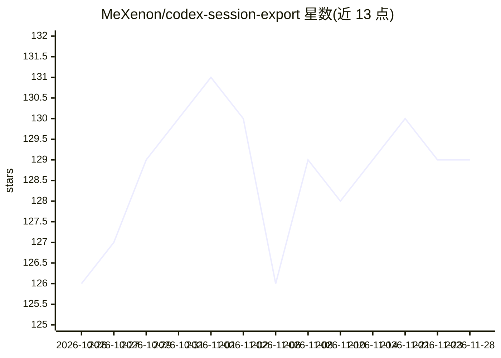

# MeXenon/codex-session-export

⭐ 129 · Python · Apache-2.0 · 推送 2026-11-17 · [GitHub](https://github.com/MeXenon/codex-session-export) · 个人维护

**面向 Codex 用户的会话日志导出与过滤终端工具**

单文件 Python CLI/TUI 工具（codex-md.py），解析本地 ~/.codex/sessions 下的 .jsonl（含 .zst 压缩）会话日志，以全屏交互终端界面按项目分组浏览，提供 20 个可开关分区（用户/Agent 消息、隐藏推理、终端命令、MCP 调用等）、最近 N 轮、Live Context 上下文窗口还原、输出行数上限与 7 个预设，导出为 Markdown 文件或复制到剪贴板。无强制依赖，Python <3.14 处理压缩日志需可选安装 backports.zstd。

## 筛选速览

| 维度 | 判定 | 备注 |
|---|---|---|
| AI 角色 | `ai-ecosystem` | LLM/agent 周边工具 |
| 许可风险 | `permissive` | Apache-2.0 |
| 部署形态 | `library` | 以包/库形式分发 |
| 模型依赖 | — | README 未给出锁定关系 |
| 硬件要求 | — | 无带数字的原话,不猜 |
| 安装摩擦 | `low` | 无编译、无系统依赖或容器化 |
| 成熟度 | — | 结构信号不足 |

## 能力要点

- 解析本地 .jsonl/.zst 会话日志并按项目分组分页浏览
- 20 个可过滤分区与 7 个导出预设，支持最近 N 轮与输出行数上限
- Live Context 还原模型当前上下文窗口与 token 用量
- 导出为 Markdown 文件或复制到剪贴板

## 适用场景

- 把 Codex 会话导出给其他模型做调试或代码审查
- 提取会话中的终端命令生成自动化脚本
- 剥离冗长工具输出，只阅读实际对话与隐藏推理

## 场景标签

 · 领域:开发工具/AI 会话管理

## 证据(README 行号)

> L27: **Codex Session Manager** (`codex-md.py`) is designed for maximum flexibility. It parses your local `.jsonl` sessio
> L29: Because it’s a pure Python CLI tool, it's completely **portable**. You can use it locally on your laptop, or run it

## 星数曲线

2026-10-26 126 → 2026-11-28 129（+3）

---
*卡片 v1 · prompt 1.4 · 生成 2026-11-28 · 置信度 mid · 依据 README sha `482a00c2a842` · [字段定义](../../DATASET.md)*
