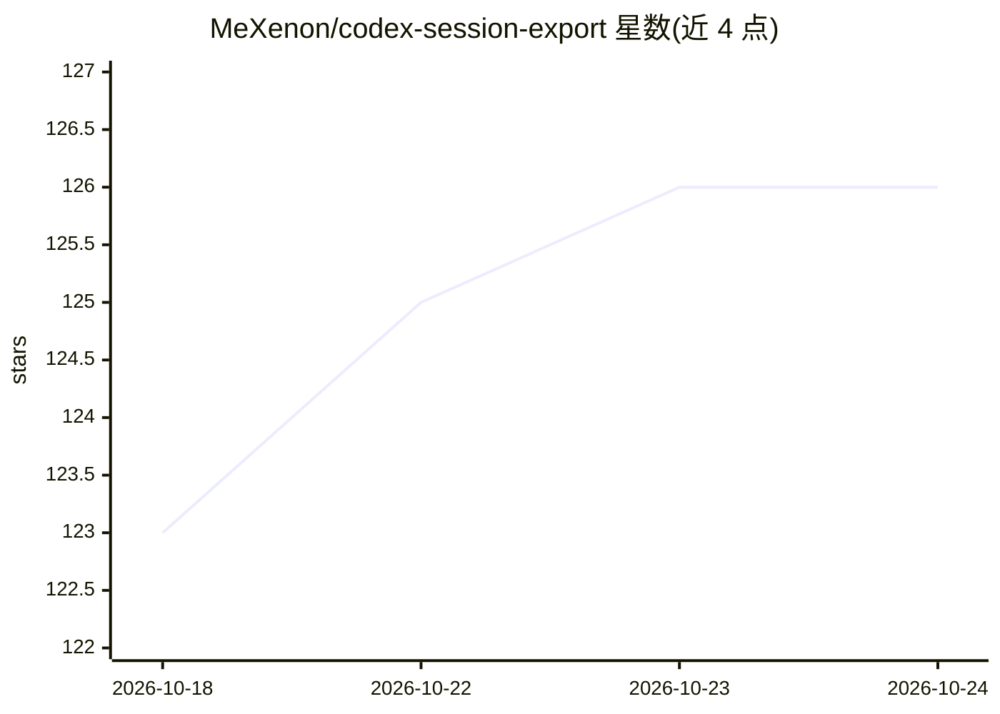

# MeXenon/codex-session-export

⭐ 126 · Python · Apache-2.0 · 推送 2026-09-16 · [GitHub](https://github.com/MeXenon/codex-session-export) · 个人维护

**Codex 会话日志导出工具：解析 .jsonl 并按需筛选生成 Markdown**

纯 Python 单文件 CLI/TUI 工具，扫描 ~/.codex/sessions 下的本地 .jsonl 会话日志，通过交互式全屏终端界面按项目分组浏览会话，支持 20 类可筛选区块（用户/Agent 消息、隐藏推理、终端命令、MCP 调用等）、并行批量导出、终端输出截断、最近 N 轮提取与 Live Context 上下文窗口重建，输出为 Markdown 文件或剪贴板内容。面向使用 Codex CLI/桌面版的开发者，用于会话分析、调试与喂给其他模型；无复杂依赖，仅要求 Python 3.x。

## 筛选速览

| 维度 | 判定 | 备注 |
|---|---|---|
| AI 角色 | `ai-ecosystem` | LLM/agent 周边工具 |
| 许可风险 | `permissive` | Apache-2.0 |
| 部署形态 | `None` |  |
| 模型依赖 | — | README 未给出锁定关系 |
| 硬件要求 | — | 无带数字的原话,不猜 |
| 安装摩擦 | `low` | 无编译、无系统依赖或容器化 |
| 成熟度 | — | 结构信号不足 |

## 能力要点

- 交互式 TUI 按 20 类区块筛选会话内容并导出 Markdown
- Live Context 模式逆向解析日志还原模型活跃上下文窗口与 token 用量
- 项目分组视图、会话 ID 检索与并行批量导出
- 终端输出截断（1–500 行）与 Clean Chat 模式精简上下文

## 适用场景

- 导出 Codex 会话给其他 AI 模型做调试或代码审查
- 从会话中提取终端命令生成自动化脚本
- 查看 Agent 的隐藏内部推理过程
- 截断冗长工具输出以控制喂给模型的上下文长度

## 场景标签

 · 领域:开发者工具/AI 会话管理

## 证据(README 行号)

> L27: **Codex Session Manager** (`codex-md.py`) is designed for maximum flexibility. It parses your local `.jsonl` sessio
> L29: Because it’s a pure Python CLI tool, it's completely **portable**. You can use it locally on your laptop, or run it

## 星数曲线

2026-10-18 123 → 2026-10-24 126（+3）

---
*卡片 v1 · prompt 1.4 · 生成 2026-10-23 · 置信度 high · 依据 README sha `174bc4533b93` · [字段定义](../../DATASET.md)*
