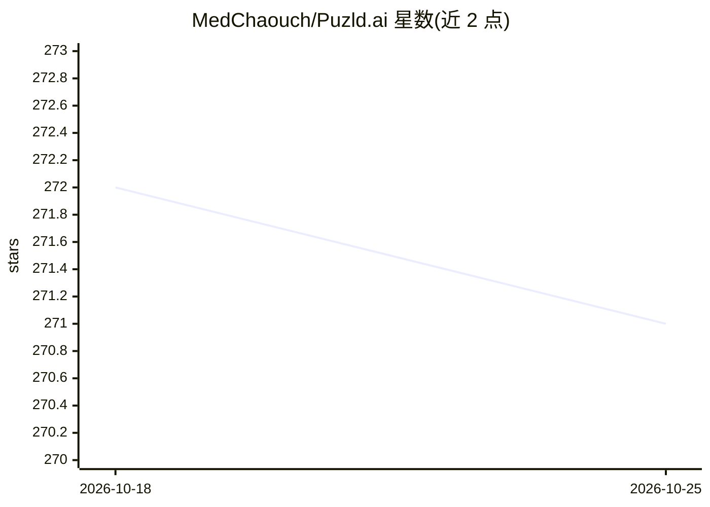

# MedChaouch/Puzld.ai

⭐ 271 · TypeScript · AGPL-3.0 · 推送 2026-01-01 · [GitHub](https://github.com/MedChaouch/Puzld.ai) · [官网](https://docs.puzld.cc) · 个人维护

**终端多 LLM 编排框架：路由、协作、代理执行与训练数据生成**

面向开发者的终端原生 AI 编排框架，用 npm 安装并以 TUI/CLI 运行。将任务路由到多个 agent（Claude、Gemini、Codex、Ollama、Mistral），支持单 agent、对比、管道、工作流、Autopilot 计划执行及 Correct/Debate/Consensus 等多 agent 协作模式。Agentic 模式给 LLM 提供文件浏览与编辑工具并以权限提示执行；Memory/RAG 用 SQLite FTS5 或 Ollama 嵌入做语义检索；Observation 层记录交互并导出 DPO 训练对。各 agent 需对应 CLI 已安装方可使用。

## 筛选速览

| 维度 | 判定 | 备注 |
|---|---|---|
| AI 角色 | `ai-ecosystem` | LLM/agent 周边工具 |
| 许可风险 | `viral` | AGPL-3.0 |
| 部署形态 | `library` | 以包/库形式分发 |
| 模型依赖 | local-ok | 支持本地模型 |
| 硬件要求 | — | 无带数字的原话,不猜 |
| 安装摩擦 | `low` | 无编译、无系统依赖或容器化 |
| 成熟度 | — | 结构信号不足 |

## 能力要点

- 多种执行模式：对比、管道、工作流、Autopilot、Correct/Debate/Consensus 协作
- Agentic 模式：LLM 通过 view/glob/grep/bash 等工具浏览代码库并提出带权限提示的文件编辑
- Memory/RAG 基于 SQLite FTS5（零依赖）或 Ollama 嵌入的语义检索
- 记录全部交互并导出 DPO 偏好对用于微调

## 适用场景

- 把同一问题发给多个模型对比回答后择优
- 用管道把分析、编码、评审等步骤串给不同 agent
- 让 LLM 在权限确认下浏览并修改代码库
- 积累编辑决策导出为微调训练数据

## 场景标签

`多智能体` `Agent 框架` `编码 Agent` · 领域:Agent 开发

## 证据(README 行号)

> L17: PuzldAI is a terminal-native framework for orchestrating multiple AI agents. Route tasks to the best agent, compare
> L50: ## Supported Agents

## 星数曲线

2026-10-18 272 → 2026-10-25 271（-1）

---
*卡片 v1 · prompt 1.4 · 生成 2026-10-22 · 置信度 high · 依据 README sha `5ba2ddd05d80` · [字段定义](../../DATASET.md)*
