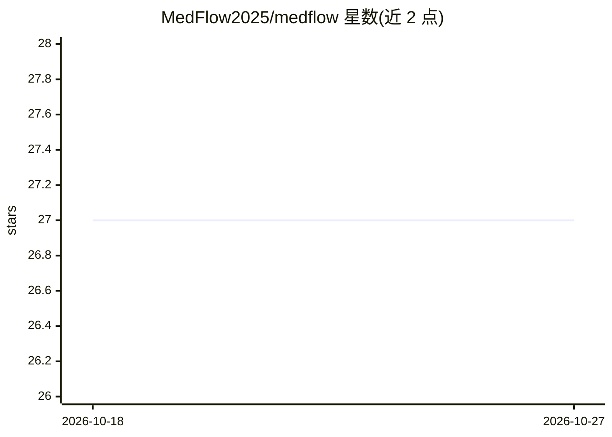

# MedFlow2025/medflow

⭐ 27 · Shell · Apache-2.0 · 推送 2026-07-21 · [GitHub](https://github.com/MedFlow2025/medflow) · 组织维护 · 中文 README

**面向医疗机构的端到端 AI 诊疗全流程框架**

覆盖诊前、诊中、诊后全流程的 AI 医疗框架：通过 HTTP 服务接口提供智能分诊、挂号、病历生成与质控、疾病诊断、开检查单、处方生成、随访管理共 12 类功能模块，服务对象含患者、医师、医院管理员。模型经 OpenAI 兼容服务接入（DeepSeek/Qwen/Llama/Baichuan 等），并发布基于 Qwen2.5-72B、GLM4-9B 微调的医疗模型及 ASR/TTS 模型。附带 RAG 知识库导入、Gradio WebUI 与 curl 测试示例；代码与模型遵循 Apache 2.0，输出准确性不做保证。

## 筛选速览

| 维度 | 判定 | 备注 |
|---|---|---|
| AI 角色 | `ai-native` | 本体是模型或模型工具 |
| 许可风险 | `permissive` | Apache-2.0 |
| 部署形态 | `self-host` | docker 或自建部署 |
| 模型依赖 | local-ok | 支持本地模型 |
| 硬件要求 | — | 无带数字的原话,不猜 |
| 安装摩擦 | `low` | 无编译、无系统依赖或容器化 |
| 成熟度 | — | 结构信号不足 |

## 能力要点

- 12 个诊疗功能模块覆盖诊前/诊中/诊后（挂号、病历、诊断、处方等）
- 经 OpenAI 兼容接口接入 DeepSeek/Qwen/Llama/Baichuan 等模型
- 发布微调医疗模型 Qingnang-72B/9B 及中文/粤语 ASR、TTS 模型
- 提供可定制知识库导入（LLM+检索）与 Gradio WebUI

## 适用场景

- 医院构建智能分诊、挂号与随访对话系统
- 医师生成病历、获取诊断与用药推荐辅助
- 互联网医院/远程医疗场景部署医疗对话服务

## 场景标签

`RAG` `聊天机器人` · 领域:对话与助手

## 证据(README 行号)

> L18: Qingnang Smart Diagnosis is an **end-to-end AI healthcare framework** with **field-proven application capabilities*
> L24: + High-Compatibility Deployment: Allows direct access to various models via OpenAI services.
> L63: |Function|Process Stage|Type|Users|

## 星数曲线

2026-10-18 27 → 2026-10-27 27（+0）

---
*卡片 v1 · prompt 1.4 · 生成 2026-10-26 · 置信度 mid · 依据 README sha `5f5aa78fe605` · [字段定义](../../DATASET.md)*
