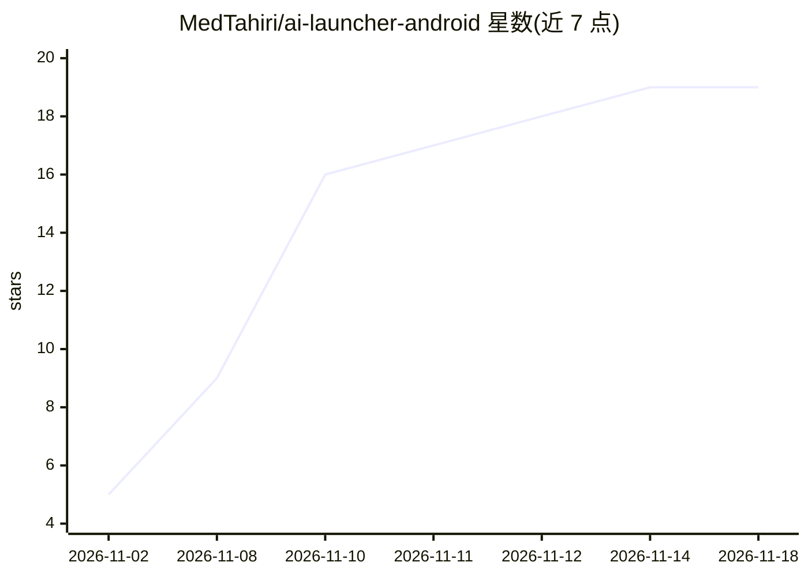

# MedTahiri/ai-launcher-android

⭐ 19 · Kotlin · MIT · 推送 2026-11-10 · [GitHub](https://github.com/MedTahiri/ai-launcher-android) · 个人维护

**由 AI 编码代理定制并安装的 Android 开源启动器**

开源 Android 主屏启动器，设计为让 AI 编码代理（如 Claude Code）按用户自然语言描述修改代码、通过 adb 安装到手机并自动截图验证。仓库提供已可运行的启动器（simple/glass 两种风格）、launcher.json 配置文件、AGENTS.md 代理指令、doctor.sh/verify.sh 等工具链，以及崩溃后进入安全模式的兜底机制。默认无 INTERNET 权限，新增权限受 permissions.allow 约束。也可不用代理，自行以 JDK 17+、Android SDK 构建定制。

## 筛选速览

| 维度 | 判定 | 备注 |
|---|---|---|
| AI 角色 | `ai-enhanced` | 去掉 AI 部分产品仍成立 |
| 许可风险 | `permissive` | MIT |
| 部署形态 | `None` |  |
| 模型依赖 | — | README 未给出锁定关系 |
| 硬件要求 | — | 无带数字的原话,不猜 |
| 安装摩擦 | `low` | 无编译、无系统依赖或容器化 |
| 成熟度 | — | 结构信号不足 |

## 能力要点

- AI 代理改代码→安装→截图自检的闭环工作流
- launcher.json 单文件覆盖大量定制项，含专注规则与多语言（英/法/阿）
- verify.sh 自动安装、查崩溃并存截图到 .verify/
- 默认无 INTERNET 权限，权限白名单管控，崩溃 3 次进入安全模式

## 适用场景

- 用自然语言让 AI 代理定制自己的主屏样式与功能
- 给长辈做只有大按钮和少量应用的简化手机
- 定时隐藏社交媒体等分心应用
- 作为学习 Android 开发的真实项目，由代理边改边解释

## 场景标签

 · 领域:移动应用/桌面工具

## 证据(README 行号)

> L7: An open-source Android home screen made to be changed by an AI agent. Say what you want in plain words, and your age
> L59: - A coding agent that can run commands, such as Claude Code.

## 星数曲线

2026-11-02 5 → 2026-11-18 19（+14）

---
*卡片 v1 · prompt 1.4 · 生成 2026-11-18 · 置信度 high · 依据 README sha `27ac71a52dba` · [字段定义](../../DATASET.md)*
