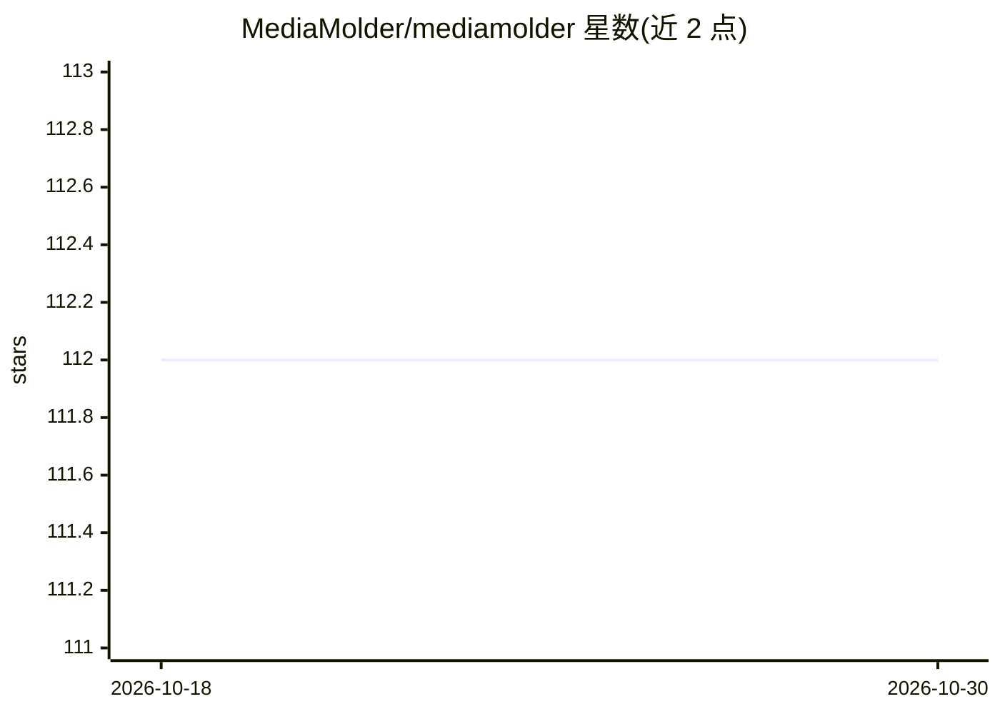

# MediaMolder/mediamolder

⭐ 112 · Go · LGPL-2.1 · 推送 2026-10-28 · [GitHub](https://github.com/MediaMolder/mediamolder) · 组织维护

**面向生产媒体处理的 FFmpeg 图形化重造引擎，内置 AI 检测/转写节点**

基于 libav* 库的 Go 媒体处理引擎，将 FFmpeg 命令行替换为 JSON 定义的图与浏览器拖拽式 GUI：支持导入/导出 FFmpeg 命令、运行前静态+探测校验与一键修复、逐节点性能指标（Prometheus/OTEL/HTTP SSE）、实时自适应编码控制器，以及多轨时间线剪辑。扩展通过纯 Go Processor 接口实现；内置 YOLO 目标检测、YOLOv8-face 人脸分析、whisper.cpp 语音转字幕、Vidi 2.5 与 TwelveLabs 视频理解、LibRaw RAW 解码等节点。面向需要长时运行与可观测性媒体管线的开发者与工程团队。

## 筛选速览

| 维度 | 判定 | 备注 |
|---|---|---|
| AI 角色 | `ai-enhanced` | 去掉 AI 部分产品仍成立 |
| 许可风险 | `viral` | LGPL-2.1 |
| 部署形态 | `None` |  |
| 模型依赖 | — | README 未给出锁定关系 |
| 硬件要求 | — | 无带数字的原话,不猜 |
| 安装摩擦 | `medium` | 含编译或系统依赖之一 |
| 成熟度 | — | 结构信号不足 |

## 能力要点

- FFmpeg 命令与可视化图双向转换，图保存为 JSON 可由二进制直接运行
- 运行前校验捕捉拓扑/编码器兼容/像素格式等问题并提供一键修复
- 实时自适应闭环控制器：线程/preset/丢帧三级适配与抖动缓冲
- 内置 YOLO 检测、whisper.cpp 转写、Vidi 2.5 / TwelveLabs 视频理解等 AI 节点

## 适用场景

- 用可视化图编辑器替代 FFmpeg 命令行构建转码管线
- 直播/长时编码任务中监控逐节点性能并自动适配
- 在媒体图中加入目标检测、人脸分析或语音字幕生成节点
- 将现有 ffmpeg 脚本迁移为可版本化的 JSON 图

## 场景标签

`图像视频处理` `语音识别` `目标检测` · 领域:感知与多模态

## 证据(README 行号)

> L9: **MediaMolder is a ground-up redesign of FFmpeg’s interface and orchestration layers.** It uses the same battle-test
> L154: You can add a YOLO object-detection node to a graph and it will
> L161: For local, offline speech-to-text, the built-in `whisper_stt` node transcribes an audio stream to timestamped subt

## 星数曲线

2026-10-18 112 → 2026-10-30 112（+0）

---
*卡片 v1 · prompt 1.4 · 生成 2026-10-23 · 置信度 high · 依据 README sha `1d7844020f2c` · [字段定义](../../DATASET.md)*
