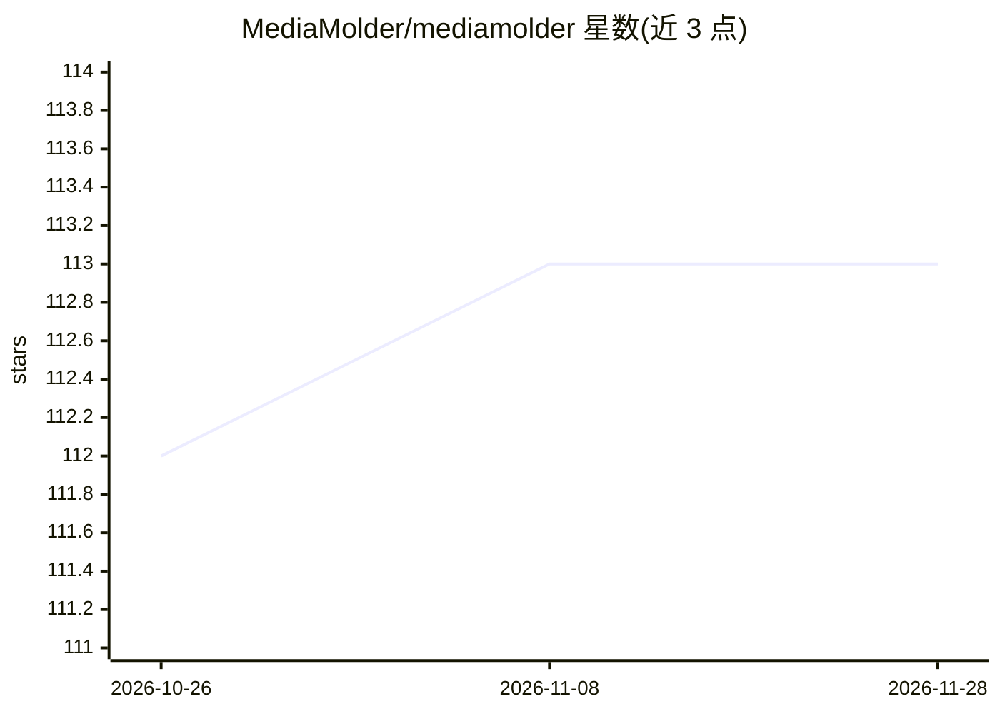

# MediaMolder/mediamolder

⭐ 113 · Go · LGPL-2.1 · 推送 2026-11-23 · [GitHub](https://github.com/MediaMolder/mediamolder) · 个人维护

**FFmpeg 的可视化重构：JSON 图形编排媒体处理，内置 AI 节点**

基于 libav* 库（libavcodec/libavformat/libavfilter/x264/x265）重建接口与编排层的媒体处理引擎，用 JSON 文件定义处理图替代命令行字符串。提供浏览器内拖放式 GUI、运行前静态+probe 校验与一键自动修复、逐节点性能指标（Prometheus/OTEL/HTTP SSE）、实时自适应控制器（线程/preset/丢帧调节）。以 Go 编写，自定义处理逻辑通过 Processor 接口以纯 Go 扩展；图以 JSON 保存并可本地、远程 GPU 服务器或集群运行，支持与 FFmpeg 命令行双向转换。

## 筛选速览

| 维度 | 判定 | 备注 |
|---|---|---|
| AI 角色 | `ai-enhanced` | 去掉 AI 部分产品仍成立 |
| 许可风险 | `viral` | LGPL-2.1 |
| 部署形态 | `None` |  |
| 模型依赖 | — | README 未给出锁定关系 |
| 硬件要求 | — | 无带数字的原话,不猜 |
| 安装摩擦 | `medium` | 含编译或系统依赖之一 |
| 成熟度 | — | 结构信号不足 |

## 能力要点

- 浏览器拖放式图形编辑器，JSON 定义处理图，可与 FFmpeg 命令行双向转换
- 运行前静态+probe 校验，对无歧义问题提供一键自动修复
- 实时自适应控制器：编码线程/preset/丢帧三级调节，500ms 控制环
- 内置 AI/分析节点：YOLOv8 检测、whisper.cpp 本地转写、Vidi 2.5、TwelveLabs、LibRaw RAW 解码、人脸检测

## 适用场景

- 把现有 ffmpeg 命令导入 GUI 可视化编辑后再运行
- 直播/HLS/DASH 场景下保持实时编码节奏
- 在媒体处理图中直接嵌入目标检测、语音转写、场景理解节点
- 长时间生产任务中按节点观测性能与瓶颈

## 场景标签

`图像视频处理` `目标检测` `语音识别` · 领域:感知与多模态

## 证据(README 行号)

> L9: **MediaMolder is a ground-up redesign of FFmpeg’s interface and orchestration layers.** It uses the same battle-test
> L154: You can add a YOLO object-detection node to a graph and it will
> L161: For local, offline speech-to-text, the built-in `whisper_stt` node transcribes an audio stream to timestamped subt

## 星数曲线

2026-10-26 112 → 2026-11-28 113（+1）

---
*卡片 v1 · prompt 1.4 · 生成 2026-11-28 · 置信度 high · 依据 README sha `31f3676a816b` · [字段定义](../../DATASET.md)*
