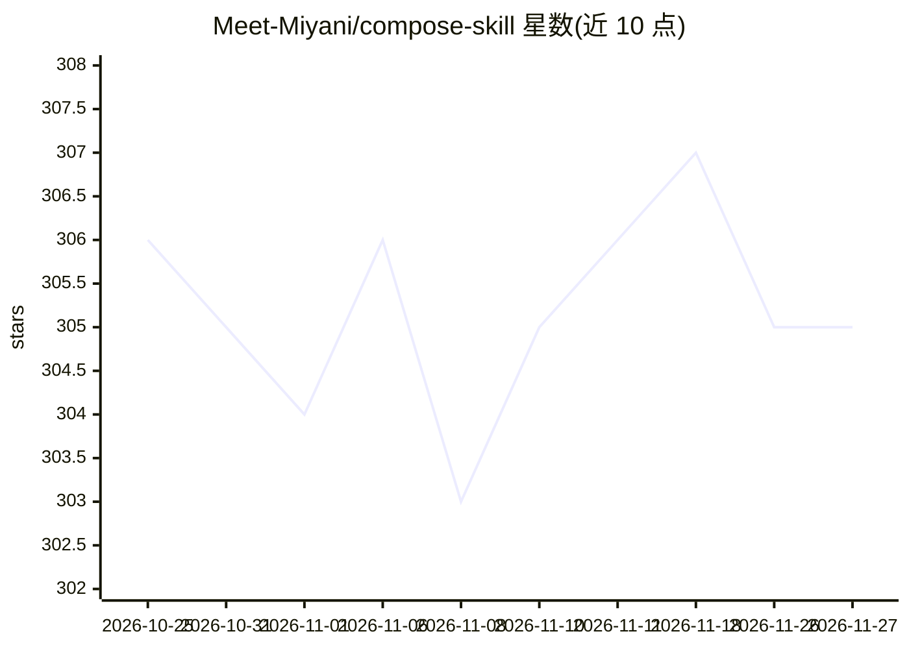

# Meet-Miyani/compose-skill

⭐ 305 · Shell · MIT · 推送 2026-11-08 · [GitHub](https://github.com/Meet-Miyani/compose-skill) · [官网](https://compose.avinya.dev) · 个人维护

**给 AI 编码代理的 Jetpack Compose 技能包，统一代码风格**

面向 AI 编码代理的 7 个技能集合，覆盖 MVI 架构、Koin DI、Navigation 3、Ktor、Room 等 Compose/Compose Multiplatform 主题。机制上采用约 1.3k token 的入口决策树做渐进加载（全量约 127k token），仅加载当前任务所需参考文件；附带 11 个 shell guard 脚本与 90 个 fixture 测试在 CI 中检查风格漂移。提供 npx skills、gh skill、Claude Code 插件、Codex 插件四种安装通道，支持项目级或全局安装。作者以盲评 agentic runs 报告各模型的评分提升数据。

## 筛选速览

| 维度 | 判定 | 备注 |
|---|---|---|
| AI 角色 | `ai-ecosystem` | LLM/agent 周边工具 |
| 许可风险 | `permissive` | MIT |
| 部署形态 | `library` | 以包/库形式分发 |
| 模型依赖 | — | README 未给出锁定关系 |
| 硬件要求 | — | 无带数字的原话,不猜 |
| 安装摩擦 | `low` | 无编译、无系统依赖或容器化 |
| 成熟度 | — | 结构信号不足 |

## 能力要点

- 7 个技能 + 约 1.3k token 入口决策树的渐进式加载
- 11 个 shell guard 脚本与 90 个 fixture 测试用于 CI 中检查代码漂移
- 提供 npx skills / gh skill / Claude Code 插件 / Codex 插件四种安装通道
- README 附带多模型盲评 agentic runs 的结果与预注册规则

## 适用场景

- 让编码代理按统一的 MVI + Koin 风格写 Compose 代码
- 团队在仓库中共享一致的 Compose 编码规范给代理使用
- 在 CI 中用 guard 脚本捕获代理产出的风格漂移

## 场景标签

`编码 Agent` `提示工程` · 领域:Agent 开发

## 证据(README 行号)

> L3: **A Compose skill for AI coding agents: seven agent skills that make Claude Code, Codex, Cursor, Copilot and Gemini
> L53: - **Progressive loading:** a ~1.3k-token entry tree picks the task path and the exact reference files. The full kit
> L63: |**`compose`**|The entry decision tree (~1.3k tokens): task kind → affected area → exact reference files|

## 星数曲线

2026-10-25 306 → 2026-11-27 305（-1）

---
*卡片 v1 · prompt 1.4 · 生成 2026-11-25 · 置信度 high · 依据 README sha `05be0f7b488c` · [字段定义](../../DATASET.md)*
