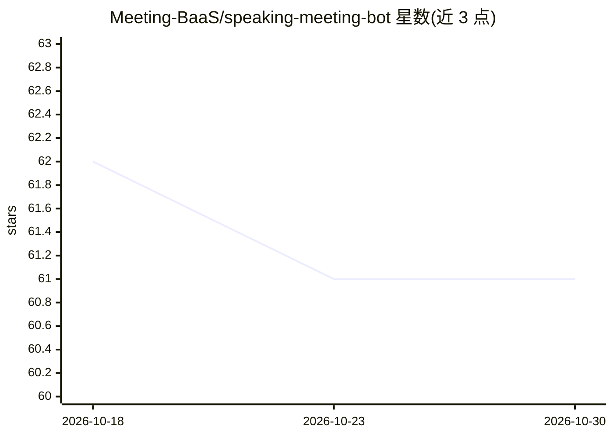

# Meeting-BaaS/speaking-meeting-bot

⭐ 61 · Python · MIT · 推送 2026-10-28 · [GitHub](https://github.com/Meeting-BaaS/speaking-meeting-bot) · 组织维护

**可加入 Google Meet/Teams 会议的 AI 语音机器人，基于 Pipecat**

在 Pipecat 语音代理框架之上构建的会议机器人服务：通过 MeetingBaas API 派机器人加入 Google Meet 与 Microsoft Teams，用 Markdown 文件定义人格与知识库，经 WebSocket 实时收发音频。语音链路为 Cartesia TTS、Gladia/Deepgram STT，LLM 可按请求在 OpenAI、Anthropic、Z.ai 间切换；支持为每个机器人挂载外部提示上下文与 MCP 服务器（本地 stdio 不接受，私网目标默认阻断）。以 FastAPI + Poetry 提供，需配置多个 API key。

## 筛选速览

| 维度 | 判定 | 备注 |
|---|---|---|
| AI 角色 | `ai-native` | 本体是模型或模型工具 |
| 许可风险 | `permissive` | MIT |
| 部署形态 | `None` |  |
| 模型依赖 | locked-api |  |
| 硬件要求 | — | 无带数字的原话,不猜 |
| 安装摩擦 | `low` | 无编译、无系统依赖或容器化 |
| 成熟度 | — | 结构信号不足 |

## 能力要点

- Markdown 定义人格（性格、知识库、语音特征），多语言支持
- 通过 /run-bots API 派机器人加入会议并支持多实例
- 按请求选择 LLM：openai/anthropic/zai，凭据仅存服务端环境变量
- 每机器人可挂 MCP 服务器（mcp_profile 预设、工具白名单、读写分级）

## 适用场景

- 派带独立人格的语音 AI 参加线上会议
- 通过 API 批量管理多个会议机器人实例
- 为会议机器人挂载外部文档上下文和 MCP 工具

## 场景标签

`语音 Agent` · 领域:对话与助手

## 证据(README 行号)

> L7: This repository expands upon Pipecat's Python framework for building voice and multimodal conversational agents. Our
> L29: In this implementation, Pipecat is integrated with Cartesia for speech generation (text-to-speech), Gladia or Deepg
> L285: `llm_model`. Supported providers are `openai`, `anthropic`, and `zai`.

## 星数曲线

2026-10-18 62 → 2026-10-30 61（-1）

---
*卡片 v1 · prompt 1.4 · 生成 2026-10-24 · 置信度 high · 依据 README sha `6c188f3a2f98` · [字段定义](../../DATASET.md)*
