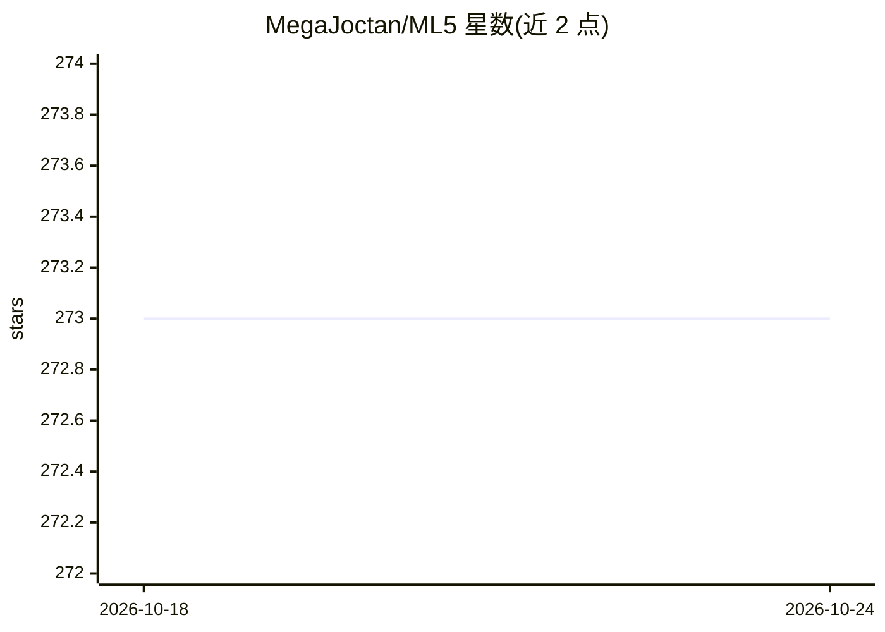

# MegaJoctan/ML5

⭐ 273 · MQL5 · MIT · 推送 2026-09-18 · [GitHub](https://github.com/MegaJoctan/ML5) · [官网](https://omegafx.co) · 个人维护

**MQL5 语言的机器学习与数据科学库，供交易机器人开发**

面向 MetaTrader 5 平台的 MQL5 编程语言提供的类 Python 风格机器学习与数据科学代码库，主题涵盖机器学习算法与 MQL5 API。安装方式为从 GitHub releases 下载 zip 或克隆仓库，将 ML5 文件夹解压至 MetaTrader 5 终端数据路径的 Include 父目录下。项目通过 GitHub issues 接收缺陷报告与功能请求，并以捐赠、经纪商推荐（ICMarkets）与 MQL5.com 接单方式寻求支持。README 未列出具体算法清单与使用示例。

## 筛选速览

| 维度 | 判定 | 备注 |
|---|---|---|
| AI 角色 | `ai-native` | 本体是模型或模型工具 |
| 许可风险 | `permissive` | MIT |
| 部署形态 | `None` |  |
| 模型依赖 | — | README 未给出锁定关系 |
| 硬件要求 | — | 无带数字的原话,不猜 |
| 安装摩擦 | `low` | 无编译、无系统依赖或容器化 |
| 成熟度 | — | 结构信号不足 |

## 能力要点

- 以 MQL5 语言实现的机器学习与数据科学代码库
- 通过 releases 的 zip 或克隆方式安装到 MetaTrader 5 Include 目录
- 面向 MQL5 API 与交易机器人开发场景

## 适用场景

- 在 MetaTrader 5 中直接调用机器学习功能开发交易机器人
- 不依赖 Python 环境在 MQL5 代码里做数据分析

## 场景标签

`金融量化` · 领域:学习与行业

## 证据(README 行号)

> L5: Python-like Machine Learning & Data Science Repository for the MQL5 Programming Language.

## 星数曲线

2026-10-18 273 → 2026-10-24 273（+0）

---
*卡片 v1 · prompt 1.4 · 生成 2026-10-22 · 置信度 mid · 依据 README sha `f778d5e5a931` · [字段定义](../../DATASET.md)*
