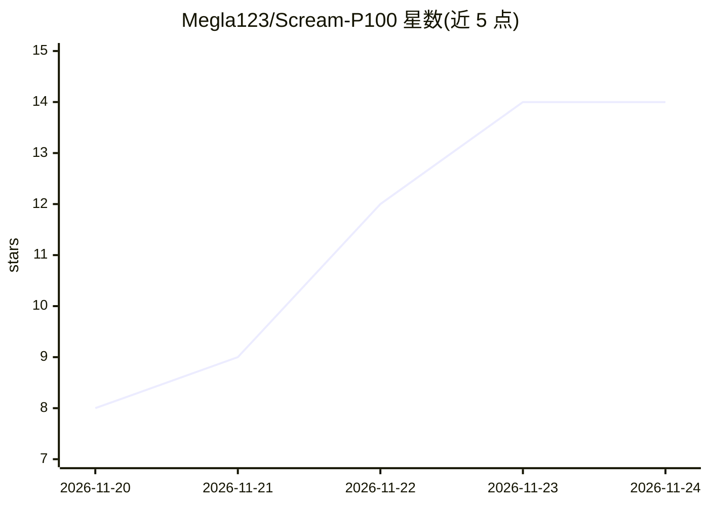

# Megla123/Scream-P100

⭐ 14 · Cuda · MIT · 推送 2026-11-22 · [GitHub](https://github.com/Megla123/Scream-P100) · 个人维护

**在两张退役 Tesla P100 上运行大 MoE 模型的推理引擎移植**

Strata split engine (strata-split-2) 到 NVIDIA Tesla P100 (Pascal, sm_60) 的移植版本，用于在两张 16 GB P100 上运行 Qwen3.8-Flash-Next 与 Edge0-145B（512k 上下文）。机制：分层切分（非流水线）让两张卡同时读取权重，约 60% 专家驻留 RAM 按需经 PCIe 流入，MTP 层与 prompt lookup 两种草稿机制实现投机解码；默认精确输出（KL 0），有损开关默认关闭。通过 git clone 后 build.sh 编译、setup.sh 下载模型、run.sh 提供 OpenAI 兼容 API。仅支持 Linux 与恰好两张 P100，拒绝其他卡。

## 筛选速览

| 维度 | 判定 | 备注 |
|---|---|---|
| AI 角色 | `ai-ecosystem` | LLM/agent 周边工具 |
| 许可风险 | `permissive` | MIT |
| 部署形态 | `None` |  |
| 模型依赖 | — | README 未给出锁定关系 |
| 硬件要求 | — | 无带数字的原话,不猜 |
| 安装摩擦 | `high` | 编译与系统依赖俱全 |
| 成熟度 | — | 结构信号不足 |

## 能力要点

- 双卡分层切分设计，两张卡同时读取权重
- MTP 草稿层 + prompt lookup（至多 15 tokens）投机解码
- 默认精确输出，有损开关默认关闭
- 另含 branch m40-2x 的双 Tesla M40 测试构建

## 适用场景

- 在家用服务器上本地运行 145B 级 MoE 模型
- 通过 OpenAI 兼容 API 接入本地应用
- 为老款 Pascal/Maxwell GPU 适配本地推理

## 场景标签

`推理引擎` · 领域:训练与推理

## 证据(README 行号)

> L18: Scream P100 is a port of Strata's all-cards split engine (`strata-split-2`, from
> L20: built for. Both cards work on every layer at once, the experts that do not fit in VRAM stream in from RAM over PCIe
> L50: bash run.sh /data/flash-next     # OpenAI-compatible API on http://127.0.0.1:8080/v1 after about 5 minutes

## 星数曲线

2026-11-20 8 → 2026-11-24 14（+6）

---
*卡片 v1 · prompt 1.4 · 生成 2026-11-21 · 置信度 high · 依据 README sha `4be9d5b8310a` · [字段定义](../../DATASET.md)*
