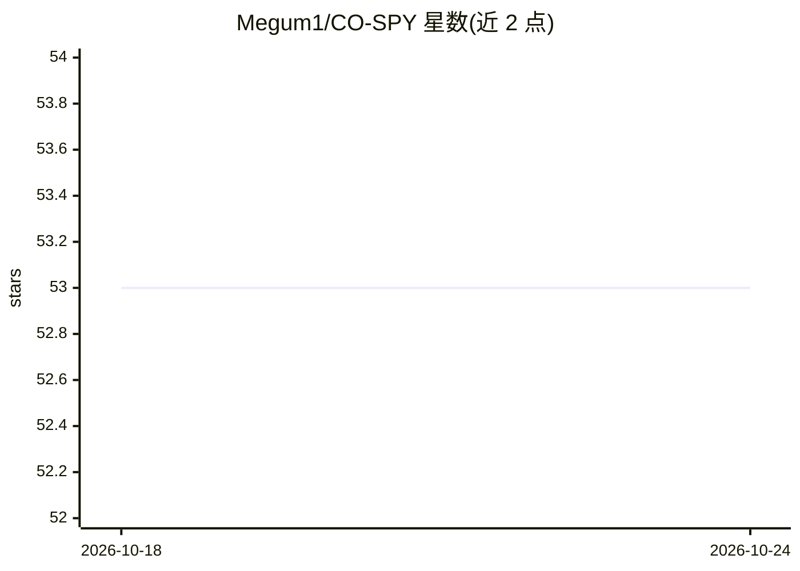

# Megum1/CO-SPY

⭐ 53 · Python · MIT · 推送 2026-05-04 · [GitHub](https://github.com/Megum1/CO-SPY) · [官网](https://www.cs.purdue.edu/homes/cheng535/) · 组织维护

**CVPR'25 论文官方实现：结合语义与像素特征检测 AI 生成图像**

CO-SPY 是 CVPR 2025 论文的官方 PyTorch 实现，通过融合语义分支与伪影（artifact）分支及校准步骤检测 AI 合成图像。提供预训练权重（基于 CNNDet 与 DRCT-2M 训练）、单图推理命令行、端到端与分支分开训练两种流程，并发布 CO-SPY-Bench 基准（覆盖 22 种生成模型、五个真实数据集的提示词）。README 要求 Python 3.8、PyTorch 2.4.1、CUDA 12.1，需自行下载训练/测试数据集与权重；部分 in-the-wild 样本因版权原因未发布。

## 筛选速览

| 维度 | 判定 | 备注 |
|---|---|---|
| AI 角色 | `ai-native` | 本体是模型或模型工具 |
| 许可风险 | `permissive` | MIT |
| 部署形态 | `None` |  |
| 模型依赖 | — | README 未给出锁定关系 |
| 硬件要求 | — | 无带数字的原话,不猜 |
| 安装摩擦 | `medium` | 含编译或系统依赖之一 |
| 成熟度 | — | 结构信号不足 |

## 能力要点

- 语义与伪影分支分别训练后校准融合的检测架构
- CO-SPY-Bench 基准：22 种生成模型、五种真实来源提示词
- 支持单图推理（输出合成概率与判定）与两种训练流程
- 提供 CNNDet/DRCT-2M 训练的预训练权重

## 适用场景

- 对单张图片判断是否为 AI 生成
- 在学术研究中复现论文实验或训练检测器
- 用 CO-SPY-Bench 评测合成图像检测方法

## 场景标签

`模型评测` · 领域:评测与运维

## 证据(README 行号)

> L13: - This is the official implementation for CVPR 2025 paper "CO-SPY: Combining Semantic and Pixel Features to Detect 
> L87: We provide the source code for training and evaluating the CO-SPY detector.

## 星数曲线

2026-10-18 53 → 2026-10-24 53（+0）

---
*卡片 v1 · prompt 1.4 · 生成 2026-10-24 · 置信度 high · 依据 README sha `1d8d525cf204` · [字段定义](../../DATASET.md)*
