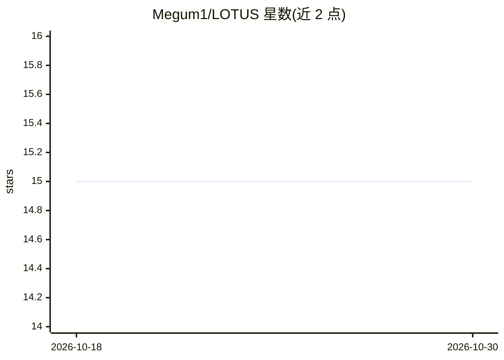

# Megum1/LOTUS

⭐ 15 · Python · MIT · 推送 2026-04-17 · [GitHub](https://github.com/Megum1/LOTUS) · [官网](https://www.cs.purdue.edu/homes/cheng535/) · 个人维护

**CVPR'24 论文 LOTUS 官方 PyTorch 实现：子划分后门攻击**

CVPR 2024 论文 LOTUS（通过子划分实现逃逸与韧性后门攻击）的 PyTorch 官方实现。代码通过三步流程训练带后门的模型：先训练干净模型，再训练用于划分的代理模型（kmeans 等划分方法），最后注入后门触发器进行投毒。支持 ResNet/VGG 架构与 CIFAR-10 数据集，输出干净模型、后门模型与各触发器/划分组合的 ASR 结果。依赖 Python 3.8、PyTorch 2.3.1 与 CUDA 12.1，面向后门攻击与模型安全研究人员。

## 筛选速览

| 维度 | 判定 | 备注 |
|---|---|---|
| AI 角色 | `ai-native` | 本体是模型或模型工具 |
| 许可风险 | `permissive` | MIT |
| 部署形态 | `None` |  |
| 模型依赖 | — | README 未给出锁定关系 |
| 硬件要求 | — | 无带数字的原话,不猜 |
| 安装摩擦 | `medium` | 含编译或系统依赖之一 |
| 成熟度 | — | 结构信号不足 |

## 能力要点

- 三步流程：干净模型→代理模型划→触发器投毒
- kmeans 等划分方法，子分区数等超参数可配置
- 支持 ResNet/VGG 架构，默认 CIFAR-10 数据集
- 输出各触发器与划分组合的 ASR 评估结果

## 适用场景

- 复现 CVPR'24 LOTUS 后门攻击论文实验
- 研究后门攻击的逃逸性与韧性机制
- 评估模型对子划分式后门攻击的脆弱性

## 场景标签

 · 领域:AI 安全/对抗机器学习

## 证据(README 行号)

> L13: - This is the PyTorch implementation for CVPR 2024 paper "LOTUS: Evasive and Resilient Backdoor Attacks through Sub
> L41: To train and evaluate a backdoored model using LOTUS, run:

## 星数曲线

2026-10-18 15 → 2026-10-30 15（+0）

---
*卡片 v1 · prompt 1.4 · 生成 2026-10-30 · 置信度 high · 依据 README sha `448f8dadd82d` · [字段定义](../../DATASET.md)*
