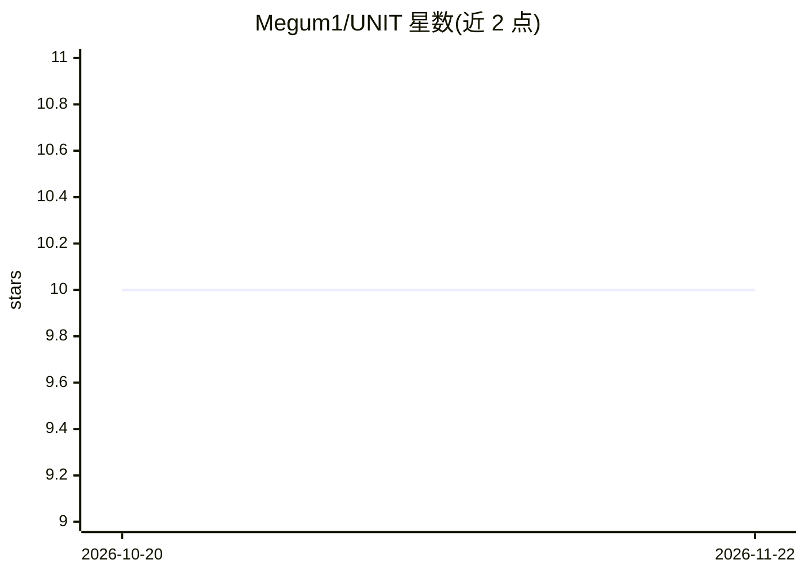

# Megum1/UNIT

⭐ 10 · Python · MIT · 推送 2025-12-18 · [GitHub](https://github.com/Megum1/UNIT) · [官网](https://www.cs.purdue.edu/homes/cheng535/) · 组织维护

**面向研究者的后门缓解防御方法 UNIT 的 PyTorch 实现**

ECCV 2024 论文 UNIT（Automated Neural Distribution Tightening）的官方 PyTorch 实现，用于缓解已训练模型中的后门攻击影响。提供对 BadNets、WaNet、Reflection 三种后门模型的评估脚本与缓解主程序，输出良性准确率与攻击成功率（ASR）及触发器可视化。默认针对 CIFAR-10 数据集与 ResNet18，超参数（如收紧步数、数据比例、精度损失容忍度）可配置；以 conda 环境方式安装，基于 Python 3.8 与 CUDA 12.1。

## 筛选速览

| 维度 | 判定 | 备注 |
|---|---|---|
| AI 角色 | `ai-native` | 本体是模型或模型工具 |
| 许可风险 | `permissive` | MIT |
| 部署形态 | `None` |  |
| 模型依赖 | — | README 未给出锁定关系 |
| 硬件要求 | — | 无带数字的原话,不猜 |
| 安装摩擦 | `medium` | 含编译或系统依赖之一 |
| 成熟度 | — | 结构信号不足 |

## 能力要点

- 内置 BadNets、WaNet、Reflection 三种后门攻击模型的评估与缓解流程
- 输出缓解前后的良性准确率与攻击成功率（ASR）及触发器可视化
- 超参数可配置：数据比例、收紧步数、精度容忍度等
- 数据集接入集中在 utils.py 的 get_dataset(*) 函数中便于修改

## 适用场景

- 评估带有 BadNets/WaNet/Reflection 后门的模型并应用 UNIT 缓解
- 在 CIFAR-10 上复现论文的后门防御实验
- 将 UNIT 方法接入自定义数据集与网络架构做防御研究

## 场景标签

 · 领域:AI 安全/机器学习研究

## 证据(README 行号)

> L13: - This is the PyTorch implementation for ECCV 2024 paper "UNIT: Backdoor Mitigation via Automated Neural Distributi
> L25:  ├── unit.py # Main function of backdoor mitigation via UNIT

## 星数曲线

2026-10-20 10 → 2026-11-22 10（+0）

---
*卡片 v1 · prompt 1.4 · 生成 2026-11-20 · 置信度 high · 依据 README sha `4053828e9e27` · [字段定义](../../DATASET.md)*
