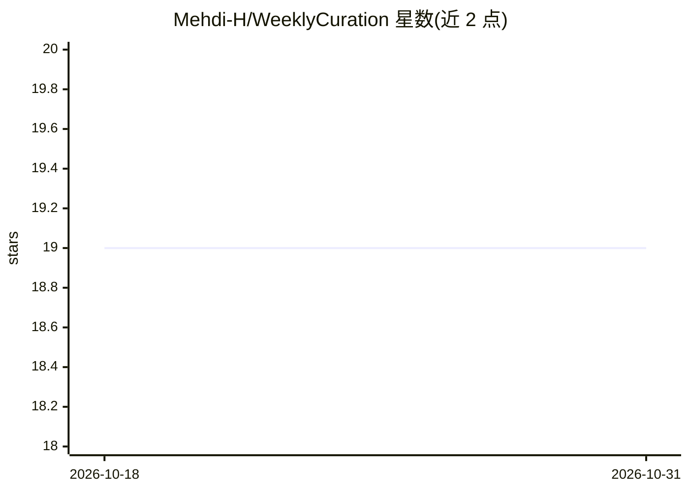

# Mehdi-H/WeeklyCuration

⭐ 19 · Makefile · MIT · 推送 2026-08-29 · [GitHub](https://github.com/Mehdi-H/WeeklyCuration) · 个人维护

**按周更新的技术链接策展清单，覆盖 AI/架构/DevOps 等主题**

个人维护的周更技术内容策展仓库：作者每周整理发现的链接，按工程管理、AI、架构、Cloud、Data、DDD、Data Mesh、DevOps & SRE、MLOps、安全、软件工程、Web 开发等分类组织，条目用图标区分文章、发布说明、工具、活动、视频、书籍、推文、播客。读者可通过在 NEXT_WEEK.md 提 PR 或建 issue 提交内容。仓库本身不含代码或可运行产品。

## 筛选速览

| 维度 | 判定 | 备注 |
|---|---|---|
| AI 角色 | `ai-knowledge` | 知识聚合/清单类 |
| 许可风险 | `permissive` | MIT |
| 部署形态 | `self-host` | docker 或自建部署 |
| 模型依赖 | — | README 未给出锁定关系 |
| 硬件要求 | — | 无带数字的原话,不猜 |
| 安装摩擦 | `low` | 无编译、无系统依赖或容器化 |
| 成熟度 | — | 结构信号不足 |

## 能力要点

- 每周按约 15 个技术分类整理链接
- 8 种图标标注内容类型（文章/发布/工具/活动/视频/书籍/推文/播客）
- 开放贡献：通过 NEXT_WEEK.md 的 PR 或 issue 提交内容

## 适用场景

- 跟踪 AI、架构、Data Mesh、DevOps 等领域的新文章与工具
- 发现技术学习资源与即将举行的行业活动
- 向社区推荐自己写作或发现的内容

## 场景标签

`精选清单` · 领域:学习与行业

## 证据(README 行号)

> L3: Interesting links I saw, every week
> L23: ## 29th of August 2026

## 星数曲线

2026-10-18 19 → 2026-10-31 19（+0）

---
*卡片 v1 · prompt 1.4 · 生成 2026-10-29 · 置信度 mid · 依据 README sha `aa43e8892605` · [字段定义](../../DATASET.md)*
