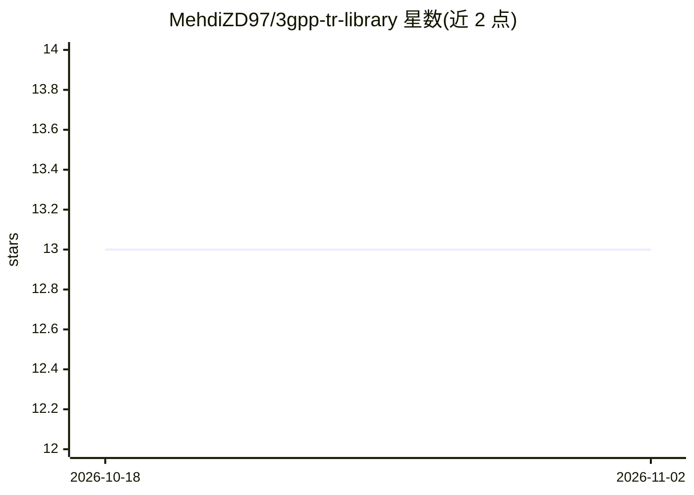

# MehdiZD97/3gpp-tr-library

⭐ 13 · Python · MIT · 推送 2026-08-04 · [GitHub](https://github.com/MehdiZD97/3gpp-tr-library) · 个人维护

**人工核验的 3GPP 技术报告章节级结构化数据库与 Python API**

将 3GPP TR 38.901、TR 36.777 中选定章节手工整理为 Markdown/CSV/YAML 三种互验格式，并经 Pydantic 类型化校验；提供 pip 安装的 tr3gpp 包（含 CLI），使仿真代码可直接查询路损公式、信道模型参数等版本固定的参数值，省去手工抄录。定位为面向 LLM 摄取/RAG 管道与无线仿真代码，覆盖优先于广度：按研究需求逐节处理并标注 planned/in-progress/verified 状态，CI 在每次推送时校验三格式一致性。数据随包分发，无需克隆仓库。

## 筛选速览

| 维度 | 判定 | 备注 |
|---|---|---|
| AI 角色 | `ai-knowledge` | 知识聚合/清单类 |
| 许可风险 | `permissive` | MIT |
| 部署形态 | `library` | 以包/库形式分发 |
| 模型依赖 | — | README 未给出锁定关系 |
| 硬件要求 | — | 无带数字的原话,不猜 |
| 安装摩擦 | `low` | 无编译、无系统依赖或容器化 |
| 成熟度 | — | 结构信号不足 |

## 能力要点

- TR 38.901 §7.4–7.6、§7.9 与 TR 36.777 Annex B 的章节级结构化数据
- tr3gpp 类型化 Python API 与 CLI，按 TR/章节/场景查询参数
- Markdown/CSV/YAML 三格式交叉校验，CI 在每次推送时强制一致
- 每个值对照 .docx、渲染 PDF、HTML 多种独立来源格式人工核验

## 适用场景

- 无线仿真代码中直接调用版本固定的 3GPP 信道模型参数
- 为 RAG 管道提供结构化、未损坏的 3GPP 表格与公式内容
- 在 pandas 中按 TR 版本 diff 对比表格数据

## 场景标签

`RAG` · 领域:知识与检索

## 证据(README 行号)

> L11: **Hand-verified, section-level 3GPP Technical Reports as queryable Markdown + CSV/YAML and a typed Python API to pu
> L15: It's built for LLM ingestion / RAG pipelines and for direct use in wireless simulation code.

## 星数曲线

2026-10-18 13 → 2026-11-02 13（+0）

---
*卡片 v1 · prompt 1.4 · 生成 2026-10-31 · 置信度 high · 依据 README sha `de0a91e3fb9d` · [字段定义](../../DATASET.md)*
