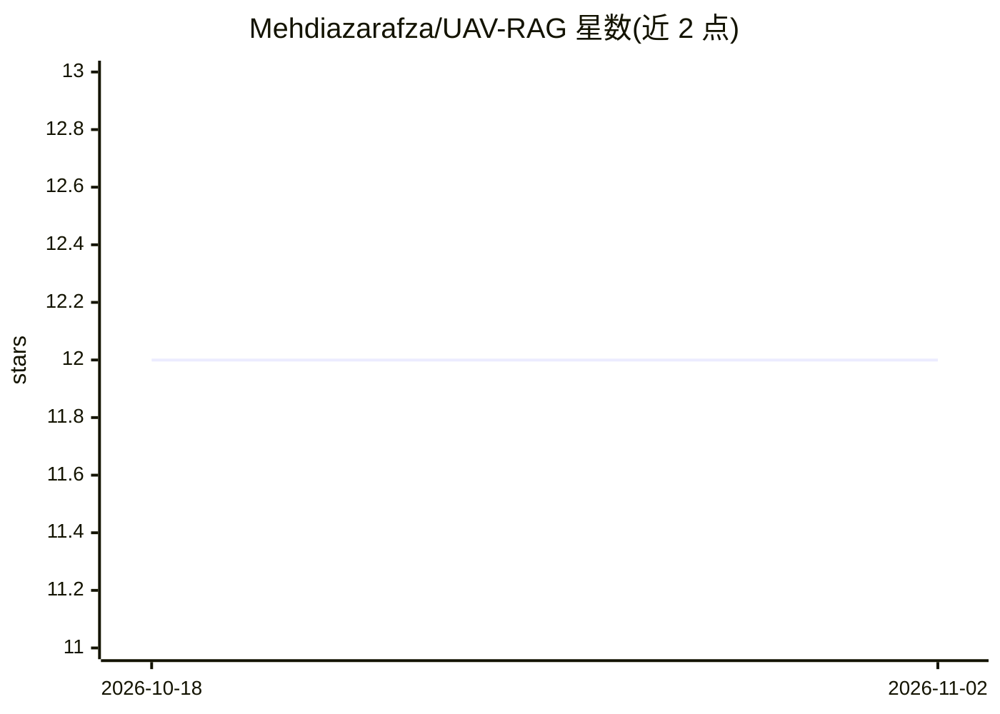

# Mehdiazarafza/UAV-RAG

⭐ 12 · 推送 2026-07-30 · [GitHub](https://github.com/Mehdiazarafza/UAV-RAG) · 组织维护

**用 RAG 评测 LLM 在无人机领域数学推理的研究仓库**

面向无人机（UAV）应用的 LLM 评测研究仓库：基于检索增强生成（RAG）对多个 LLM 做复杂算术推理与问答能力评估，被 ICLR 2026 Logical Reasoning of Large Language Models Workshop 接收。README 列出评测模型包括 Llama 3.2 3B、Llama 3.3 70B、Mistral 7B、DeepSeek、o1-preview、o1、GPT-4 Turbo、ChatGPT，并提供论文 BibTeX 引用。README 可见部分未给出安装/运行命令。

## 筛选速览

| 维度 | 判定 | 备注 |
|---|---|---|
| AI 角色 | `ai-native` | 本体是模型或模型工具 |
| 许可风险 | `none` | — |
| 部署形态 | `None` |  |
| 模型依赖 | — | README 未给出锁定关系 |
| 硬件要求 | — | 无带数字的原话,不猜 |
| 安装摩擦 | `low` | 无编译、无系统依赖或容器化 |
| 成熟度 | — | 结构信号不足 |

## 能力要点

- 基于 RAG 的无人机领域 LLM 推理与问答评测
- ICLR 2026 Logical Reasoning Workshop 接收
- 覆盖 Llama、Mistral、DeepSeek、o1、GPT-4 Turbo 等 8 类模型

## 适用场景

- 研究者复现无人机领域的 RAG 数学推理评测
- 比较不同 LLM 在领域算术推理任务上的表现
- 作为 RAG 逻辑推理研究的引用与参考工作

## 场景标签

`模型评测` · 领域:评测与运维

## 证据(README 行号)

> L3: A repository for evaluating Large Language Models (LLMs) in Unmanned Aerial Vehicle (UAV) applications using Retriev
> L4: This work was **accepted** at **ICLR 2026** Workshop on Logical Reasoning of Large Language Models.

## 星数曲线

2026-10-18 12 → 2026-11-02 12（+0）

---
*卡片 v1 · prompt 1.4 · 生成 2026-11-01 · 置信度 mid · 依据 README sha `3a23f7a08787` · [字段定义](../../DATASET.md)*
