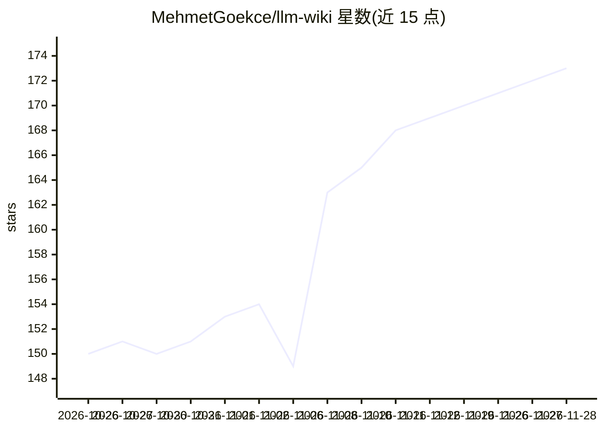

# MehmetGoekce/llm-wiki

⭐ 173 · MIT · 推送 2026-11-23 · [GitHub](https://github.com/MehmetGoekce/llm-wiki) · 个人维护

**用 Claude Code 插件构建并维护个人 LLM 知识库（wiki）**

将 Karpathy 的 LLM Wiki 构想落地为 Claude Code 插件：以 Logseq 或 Obsidian 作为 wiki 界面，通过 /llm-wiki 系列命令让模型读取原始来源、抽取实体与事实、跨页链接并保持一致性。核心机制是 L1/L2 两层缓存架构——每次会话自动加载的记忆规则（L1，git 排除可存凭据）与按需查询的深度知识页（L2）；查询采用两阶段路由（先读索引再读页面），并有 lint 健康检查、prune 冷页降级与 L1 规则时效验证。以 MIT 许可发布，支持插件安装或手动复制 SKILL.md 两种方式。

## 筛选速览

| 维度 | 判定 | 备注 |
|---|---|---|
| AI 角色 | `ai-native` | 本体是模型或模型工具 |
| 许可风险 | `permissive` | MIT |
| 部署形态 | `None` |  |
| 模型依赖 | — | README 未给出锁定关系 |
| 硬件要求 | — | 无带数字的原话,不猜 |
| 安装摩擦 | `low` | 无编译、无系统依赖或容器化 |
| 成熟度 | — | 结构信号不足 |

## 能力要点

- /llm-wiki ingest 单次来源更新 5-15 个页面并生成交叉引用
- L1/L2 缓存架构：会话自动加载规则 + 按需查询深度知识，凭据存于 git 排除的 L1
- 两阶段查询路由（hub 索引→选页→综合回答，附来源归因），grep 作 L3 兜底
- lint 13 条规则检查孤儿页、索引漂移、凭据泄漏、失效 L1 声明等

## 适用场景

- 把散乱的笔记和来源整理成互相链接的持久知识库
- 让 Claude Code 在每次会话自动带上我的项目规则与偏好
- 定期健康检查知识库，清理过期页面与失效引用

## 场景标签

`知识库管理` · 领域:知识与检索

## 证据(README 行号)

> L25: Everyone loved the concept. Almost nobody built one. The gist describes *what* to build, not *how* to wire it up wi
> L30: - **Claude becomes your wiki maintainer.** `/llm-wiki ingest` updates 5-15 pages with cross-references from a singl
> L31: - **L1/L2 architecture.** Auto-loaded rules in memory (L1) + deep knowledge in the wiki (L2). No other tool has thi

## 星数曲线

2026-10-26 150 → 2026-11-28 173（+23）

---
*卡片 v1 · prompt 1.4 · 生成 2026-11-26 · 置信度 high · 依据 README sha `b69984c1968b` · [字段定义](../../DATASET.md)*
