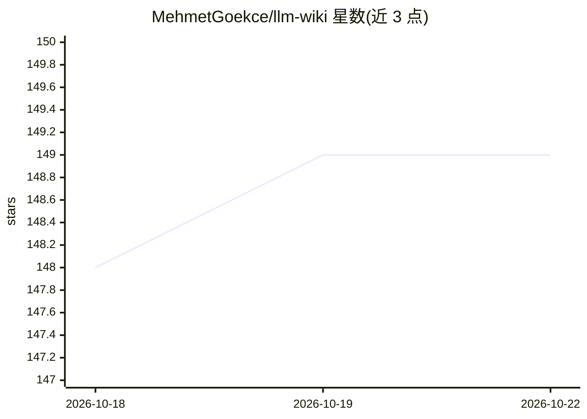

# MehmetGoekce/llm-wiki

⭐ 149 · Shell · MIT · 推送 2026-10-11 · [GitHub](https://github.com/MehmetGoekce/llm-wiki) · 个人维护

**用 Claude Code 维护个人 LLM 知识库 Wiki 的工具**

实现 Karpathy 提出的 LLM Wiki 构想：以 Claude Code 作为 LLM，Logseq 或 Obsidian 作为 Wiki 界面，提供 /llm-wiki ingest、query、prune、lint、status 等命令，从 URL/文件/文本提取事实并更新 5-15 个交叉引用页面。核心机制为两层缓存：L1 为每次会话自动加载的 Claude Memory（规则、凭据），L2 为按需查询的 Wiki 深度知识。限定运行于 Claude Code 2.1.275+，可通过插件市场安装或 git clone 运行 setup.sh。

## 筛选速览

| 维度 | 判定 | 备注 |
|---|---|---|
| AI 角色 | `ai-native` | 本体是模型或模型工具 |
| 许可风险 | `permissive` | MIT |
| 部署形态 | `None` |  |
| 模型依赖 | locked-api |  |
| 硬件要求 | — | 无带数字的原话,不猜 |
| 安装摩擦 | `low` | 无编译、无系统依赖或容器化 |
| 成熟度 | — | 结构信号不足 |

## 能力要点

- L1/L2 两层缓存架构：自动加载的规则记忆与按需查询的 Wiki 知识分层
- /ingest 处理来源并更新 5-15 个带交叉引用的页面，含质量门与报告
- /lint 检查 13 条规则：孤儿页、过期内容、断链、索引漂移、凭据泄露等
- 同时支持 Logseq 与 Obsidian 作为 Wiki 前端

## 适用场景

- 让 Claude Code 自动维护我的结构化知识库并保持一致性
- 把项目、工作流、研究资料沉淀为可交叉引用的 Wiki 页面
- 按访问热度自动归档冷页面，保持索引精简
- 审计知识库健康度并检查过期事实声明

## 场景标签

`知识库管理` · 领域:知识与检索

## 证据(README 行号)

> L9: Build Karpathy's LLM Wiki with Claude Code. Two-layer cache architecture (L1/L2). Supports Logseq and Obsidian.
> L25: Everyone loved the concept. Almost nobody built one. The gist describes *what* to build, not *how* to wire it up wi
> L30: - **Claude becomes your wiki maintainer.** `/llm-wiki ingest` updates 5-15 pages with cross-references from a singl

## 星数曲线

2026-10-18 148 → 2026-10-22 149（+1）

---
*卡片 v1 · prompt 1.4 · 生成 2026-10-22 · 置信度 high · 依据 README sha `238a0ff8c8b5` · [字段定义](../../DATASET.md)*
