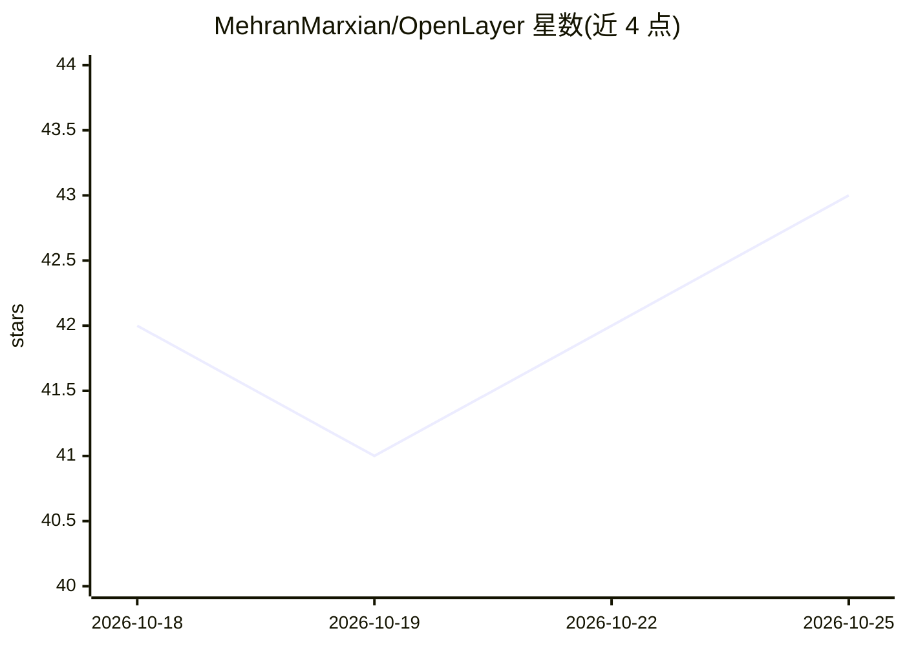

# MehranMarxian/OpenLayer

⭐ 43 · TypeScript · MIT · 推送 2026-10-18 · [GitHub](https://github.com/MehranMarxian/OpenLayer) · [官网](https://mehran-ahmadi.com/OpenLayer/) · 个人维护

**面向 Photoshop 的 ComfyUI 插件：本地生成 AI 图层并返回可编辑图层**

Adobe UXP 面板，嵌入 Photoshop 后连接本地 ComfyUI 服务器，提供 14 种生成工具（文生图、改图、局部重绘、扩图、放大、背景移除、深度/线稿/法线图、拆平图回图层等），生成结果以命名、可编辑的图层写回文档。安装经 Adobe Exchange 或 .ccx 双击，构建源码需 Node.js 18+ 与 UXP Developer Tool。要求 Photoshop 2024+、本地 ComfyUI 与 8GB+ VRAM GPU（目标 12GB）。Setup 卡片可一键下载 FLUX.2 Klein 4B（12.5GB）；Qwen-Image 2.1 预设为可选并标注研究许可。当前为 v0.39.0-alpha 公测版本，macOS 未验证。

## 筛选速览

| 维度 | 判定 | 备注 |
|---|---|---|
| AI 角色 | `ai-native` | 本体是模型或模型工具 |
| 许可风险 | `permissive` | MIT |
| 部署形态 | `desktop` | 安装包/桌面程序 |
| 模型依赖 | — | README 未给出锁定关系 |
| 硬件要求 | — | 无带数字的原话,不猜 |
| 安装摩擦 | `low` | 无编译、无系统依赖或容器化 |
| 成熟度 | `idea` | |

## 能力要点

- 14 种生成工具，结果以命名可编辑图层写回 Photoshop 文档
- ComfyUI 本地运行，无云端/订阅/账号，数据不离开本机
- Setup 一键下载 FLUX.2 Klein 4B（Apache-2.0，12.5GB）并校验
- 通过 MCP（Agent Bridge）可由 Claude 或 Codex 驱动面板工具

## 适用场景

- 在 Photoshop 内直接文生图、改图并作为图层编辑
- 局部重绘、扩图、放大与背景移除的工作流
- 把一张平面照片拆回多个带透明蒙版的图层

## 场景标签

`图像生成` · 领域:内容生成

## 证据(README 行号)

> L30: - **Fourteen generation tools**, from text-to-image and editing by instruction through inpainting and background re
> L44: **How it fits together:** ComfyUI is a free app that runs AI image models on your own graphics card.

## 星数曲线

2026-10-18 42 → 2026-10-25 43（+1）

---
*卡片 v1 · prompt 1.4 · 生成 2026-10-25 · 置信度 high · 依据 README sha `4b957365ee33` · [字段定义](../../DATASET.md)*
