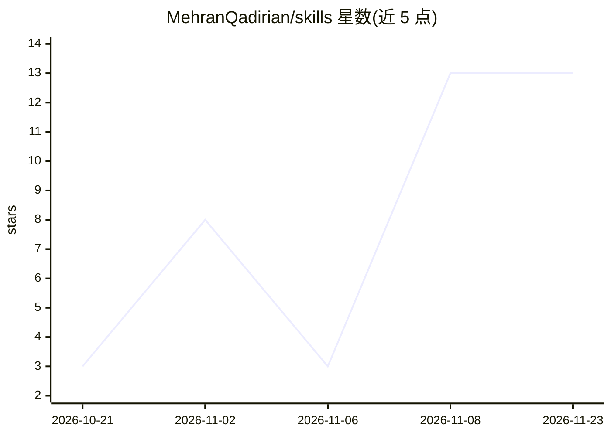

# MehranQadirian/skills

⭐ 13 · Python · 推送 2026-11-04 · [GitHub](https://github.com/MehranQadirian/skills) · 个人维护

**面向 Claude 用户的分类技能集（SKILL.md）合集**

按类别组织的即用型 Claude 技能合集，每个技能含 SKILL.md 与 README.md，部分附带经测试的辅助脚本与校验脚本 validate_skills.py。覆盖文档处理、Git、Agent 工程、软件工程、安全、数据、DevOps、语言（含波斯文本/波斯历法）、HCI 等类别。使用方式为将技能文件夹上传至 Claude.ai 设置或复制到 ~/.claude/skills/ 目录，从而为 Claude 增加新能力。

## 筛选速览

| 维度 | 判定 | 备注 |
|---|---|---|
| AI 角色 | `ai-knowledge` | 知识聚合/清单类 |
| 许可风险 | `none` | — |
| 部署形态 | `self-host` | docker 或自建部署 |
| 模型依赖 | — | README 未给出锁定关系 |
| 硬件要求 | — | 无带数字的原话,不猜 |
| 安装摩擦 | `low` | 无编译、无系统依赖或容器化 |
| 成熟度 | — | 结构信号不足 |

## 能力要点

- 按类别组织的即用型 SKILL.md 技能合集，含波斯文本与 Jalali 历法处理
- 每个技能含 SKILL.md 与 README.md，细节移入 references/ 目录
- 附带 validate_skills.py 校验脚本
- 支持 Claude.ai 上传与 Claude Code 目录复制两种安装路径

## 适用场景

- 为 Claude.ai 或 Claude Code 添加 PDF 处理、代码评审等新能力
- 获取技能编写规范并用校验脚本检查自建技能
- 在手机 Termux 环境排障时调用 termux-setup 技能

## 场景标签

`提示工程` · 领域:Agent 开发

## 证据(README 行号)

> L3: A collection of ready-to-use Claude skills, grouped by category. Drop one in and Claude gets a new ability.
> L11: |**Agent Engineering**|multi-agent-orchestration: roles, contracts and evaluation for multi-agent systems skill-aut

## 星数曲线

2026-10-21 3 → 2026-11-23 13（+10）

---
*卡片 v1 · prompt 1.4 · 生成 2026-11-18 · 置信度 mid · 依据 README sha `41e036f94c6e` · [字段定义](../../DATASET.md)*
