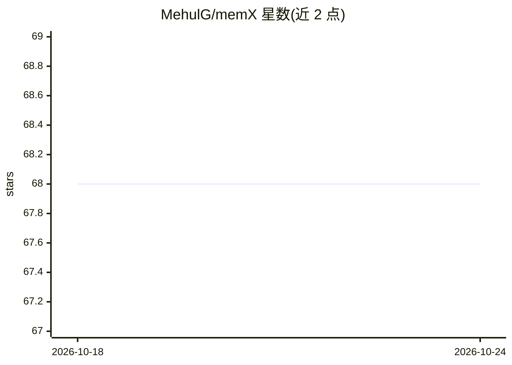

# MehulG/memX

⭐ 68 · Python · MIT · 推送 2026-01-12 · [GitHub](https://github.com/MehulG/memX) · 个人维护

**多智能体 LLM 系统的实时共享记忆层，基于 Redis**

为多智能体工作流提供实时共享记忆基础设施：FastAPI 服务暴露 set/get/schema 接口与 WebSocket 订阅，Redis 存储带时间戳的 last-write-wins 数据，按 key 做 JSON Schema 校验，API key 经 Supabase 表或本地 ACL 文件鉴权（支持读写 scope 与 glob 模式），并通过 pub/sub 推送变更通知。提供 PyPI 上的 memx-sdk Python 客户端与 Docker Compose 部署。面向需要跨 agent 同步状态、目标与上下文的开发者；限制包括尚无自动化测试、写入为 last-write-wins 语义。

## 筛选速览

| 维度 | 判定 | 备注 |
|---|---|---|
| AI 角色 | `ai-ecosystem` | LLM/agent 周边工具 |
| 许可风险 | `permissive` | MIT |
| 部署形态 | `self-host` | docker 或自建部署 |
| 模型依赖 | — | README 未给出锁定关系 |
| 硬件要求 | — | 无带数字的原话,不猜 |
| 安装摩擦 | `low` | 无编译、无系统依赖或容器化 |
| 成熟度 | — | 结构信号不足 |

## 能力要点

- HTTP + WebSocket 实时记忆同步，pub/sub 推送变更
- 按 key 的 JSON Schema 校验与 last-write-wins 写入语义
- Supabase 表或本地 ACL 的细粒度 API key 读写 scope 控制
- PyPI 提供 memx-sdk，支持 Docker Compose 一键启动

## 适用场景

- 多个 agent 协作时共享研究状态、目标与中间结果
- 为 LangGraph/AutoGen 类多智能体框架提供外置共享上下文
- 通过订阅机制让监控 agent 实时观察记忆演化

## 场景标签

`Agent 记忆` `多智能体` · 领域:Agent 开发

## 证据(README 行号)

> L1: # memX: Shared Memory for Multi-Agent LLM Systems
> L3: memX is an open-source real-time shared memory layer built for agent-based LLM systems. It synchronizes structured s
> L8: Multi-agent workflows need a reliable way to share evolving context (state, goals, thoughts) without brittle control

## 星数曲线

2026-10-18 68 → 2026-10-24 68（+0）

---
*卡片 v1 · prompt 1.4 · 生成 2026-10-24 · 置信度 high · 依据 README sha `a5ecffeabd66` · [字段定义](../../DATASET.md)*
