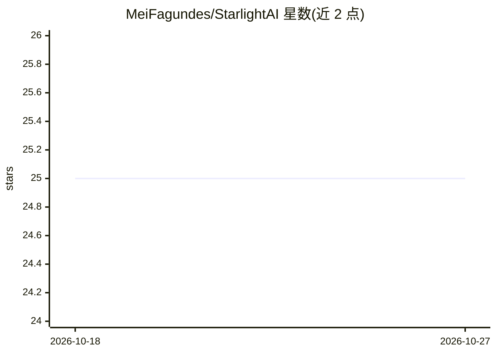

# MeiFagundes/StarlightAI

⭐ 25 · C# · GPL-3.0 · 推送 2026-10-13 · [GitHub](https://github.com/MeiFagundes/StarlightAI) · 个人维护

**C#/.NET 的自然语言意图分类引擎**

基于 ML.NET 构建的 C# 意图分类项目：为 Dataset/ 目录下每个意图文本文件训练一个二元分类器，对输入语句打分并返回含意图分数与实体字段的 JSON 结果。内置闹钟、提醒、天气、新闻、音乐、通话与闲聊等意图数据集，包含日期时间抽取类。控制台入口提示输入语句并打印结果。依赖 .NET Core 3.0 与 ML.NET 1.3.1，README 保留 2019 年原始示例。

## 筛选速览

| 维度 | 判定 | 备注 |
|---|---|---|
| AI 角色 | `ai-native` | 本体是模型或模型工具 |
| 许可风险 | `viral` | GPL-3.0 |
| 部署形态 | `None` |  |
| 模型依赖 | — | README 未给出锁定关系 |
| 硬件要求 | — | 无带数字的原话,不猜 |
| 安装摩擦 | `medium` | 含编译或系统依赖之一 |
| 成熟度 | — | 结构信号不足 |

## 能力要点

- 每个意图训练一个二元分类器并输出意图分数
- JSON 响应包含意图分数与实体字段
- 内置闹钟/提醒/天气/新闻等意图数据集
- 提供日期时间抽取类用于闹钟与提醒请求

## 适用场景

- 给语音助手类应用做语句的意图识别
- 从用户语句中抽取闹钟/提醒的时间实体
- 作为 ML.NET NLP 示例学习二元分类器训练流程

## 场景标签

 · 领域:自然语言处理

## 证据(README 行号)

> L3: Starlight is a C# natural-language intent classification project built with ML.NET. It trains a binary classifier fo
> L26: C#, .NET Core 3.0 and ML.NET 1.3.1.

## 星数曲线

2026-10-18 25 → 2026-10-27 25（+0）

---
*卡片 v1 · prompt 1.4 · 生成 2026-10-27 · 置信度 high · 依据 README sha `ff256e73e2bd` · [字段定义](../../DATASET.md)*
