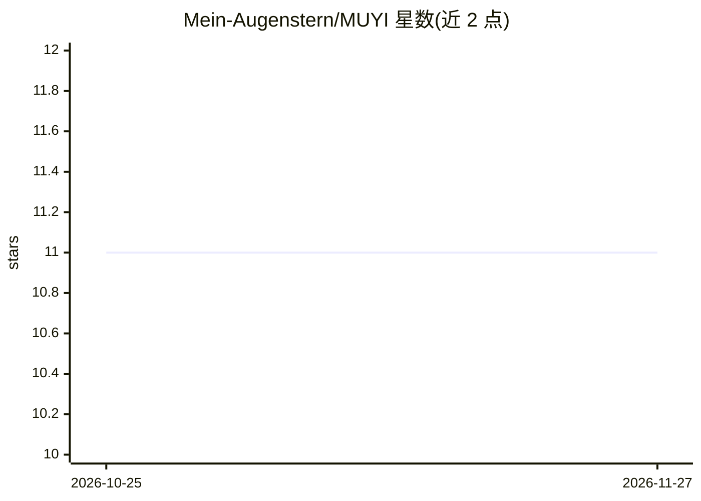

# Mein-Augenstern/MUYI

⭐ 11 · JavaScript · NOASSERTION · 推送 2026-11-26 · [GitHub](https://github.com/Mein-Augenstern/MUYI) · [官网](https://mein-augenstern.github.io/MUYI/) · 个人维护 · 中文 README

**面向后端工程师的生产级知识库：394 篇可验证文章**

按工程项目治理的后端与 AI 应用知识库，394 篇文章分 7 个轨道：后端内核（Java/MySQL/Redis/Kafka）、架构方法论（分布式/DDD）、金融信贷业务、AI 工程（RAG/Agent）、算法、前端、云原生。每篇文章从真实生产代码回写，引用真实类名与文件路径，深度文带追问链与面试官视角小结；配套 kb-upkeep 巡检脚本验证零空壳零死链，639 张配图本地化，VitePress 编译为电子书双形态发布。支持按 133 题自测清单索引备考，面向后端工程师、面试备考者与招聘方核验。

## 筛选速览

| 维度 | 判定 | 备注 |
|---|---|---|
| AI 角色 | `ai-knowledge` | 知识聚合/清单类 |
| 许可风险 | `none` | NOASSERTION |
| 部署形态 | `None` |  |
| 模型依赖 | — | README 未给出锁定关系 |
| 硬件要求 | — | 无带数字的原话,不猜 |
| 安装摩擦 | `low` | 无编译、无系统依赖或容器化 |
| 成熟度 | — | 结构信号不足 |

## 能力要点

- 文章从生产代码回写，引用真实类名与文件路径可点击验证
- 133 题自测闭环，每篇深度文带追问链与面试官视角小结
- kb-upkeep 脚本体检零空壳零死链，639 张配图全部本地化
- VitePress 电子书 + 仓库双形态，构建管线内置敏感词断言

## 适用场景

- 面试备考：按 133 题自测清单索引复习，季度过 P0 题
- 系统学习某个领域：按轨道阅读分组导航
- 招聘方/技术主管核验文章内容真实性与更新活性

## 场景标签

`教程课程` · 领域:学习与行业

## 证据(README 行号)

> L1: # MUYI · 后端工程师的生产级知识体系
> L47: ## 📚 知识体系（7 轨道 · 394 篇）
> L54: |B-AI工程|17 篇|LLM 基础（Token/上下文/幻觉/**模型选型决策表**）/ RAG（体系+切分+向量库选型）/ Agent 工程与安全（身份链/工具安全/**MCP 协议**）/ Prompt / 推理与部署（v

## 星数曲线

2026-10-25 11 → 2026-11-27 11（+0）

---
*卡片 v1 · prompt 1.4 · 生成 2026-11-19 · 置信度 high · 依据 README sha `0bfbe9c71de2` · [字段定义](../../DATASET.md)*
