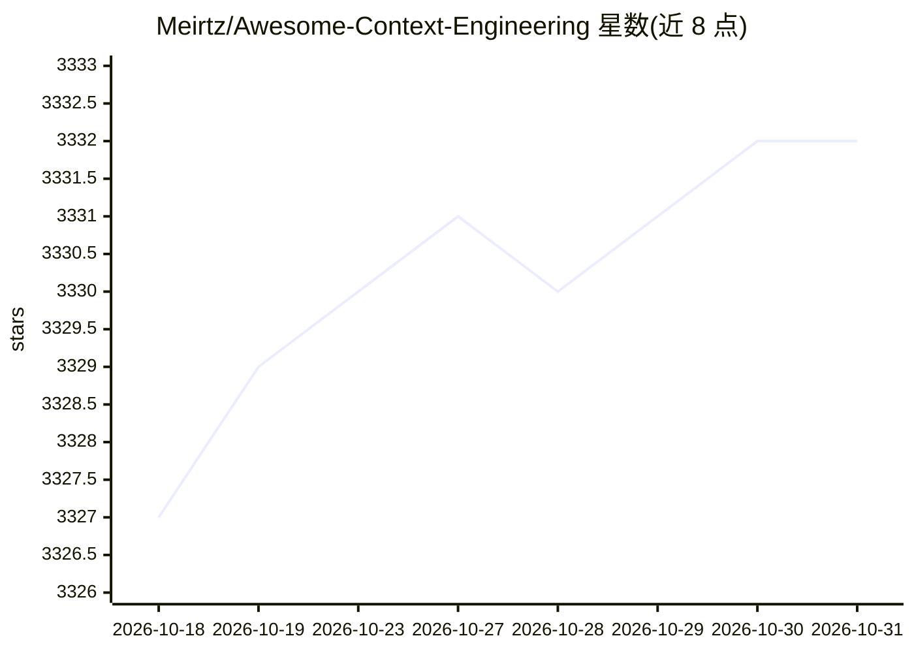

# Meirtz/Awesome-Context-Engineering

⭐ 3,332 · MIT · 推送 2026-05-28 · [GitHub](https://github.com/Meirtz/Awesome-Context-Engineering) · 个人维护 · 中文 README

**上下文工程综述资源清单：论文、框架与实现指南汇编**

Context Engineering 主题的综合调研与资源集合：从静态提示工程演进到动态上下文系统与 agent 运行时，按长上下文、RAG、记忆系统、agent 通信、工具使用、评测与应用组织条目；2026 更新增补 agent harnesses、MCP/A2A 等开放协议、编码 agent 项目记忆与可观测性等主题。配套发布 arXiv 综述论文《A Survey of Context Engineering for Large Language Models》，条目链接指向论文与开源仓库，提供微信群与 Discord 讨论。供 LLM/agent 研究者与开发者查阅文献与实现参考。

## 筛选速览

| 维度 | 判定 | 备注 |
|---|---|---|
| AI 角色 | `ai-knowledge` | 知识聚合/清单类 |
| 许可风险 | `permissive` | MIT |
| 部署形态 | `None` |  |
| 模型依赖 | — | README 未给出锁定关系 |
| 硬件要求 | — | 无带数字的原话,不猜 |
| 安装摩擦 | `low` | 无编译、无系统依赖或容器化 |
| 成熟度 | — | 结构信号不足 |

## 能力要点

- 配套 arXiv 综述论文（2025.07 发布）
- 覆盖长上下文、RAG、记忆系统、agent 通信等多主题的论文清单
- 2026 更新增补 agent 运行时、开放协议、项目记忆与可观测性方向
- 多数条目附论文链接与开源仓库链接

## 适用场景

- 系统查阅上下文工程领域的论文脉络
- 为 LLM agent 记忆/上下文系统选型寻找开源实现参考
- 跟踪 agent 时代上下文工程的新方向与工具栈

## 场景标签

`精选清单` `科研工具` · 领域:学习与行业

## 证据(README 行号)

> L18: A comprehensive survey and collection of resources on **Context Engineering** - the evolution from static prompting
> L39: This repository serves as a comprehensive survey of context engineering techniques, methodologies, and applications

## 星数曲线

2026-10-18 3,327 → 2026-10-31 3,332（+5）

---
*卡片 v1 · prompt 1.4 · 生成 2026-10-20 · 置信度 high · 依据 README sha `e7344299f83d` · [字段定义](../../DATASET.md)*
