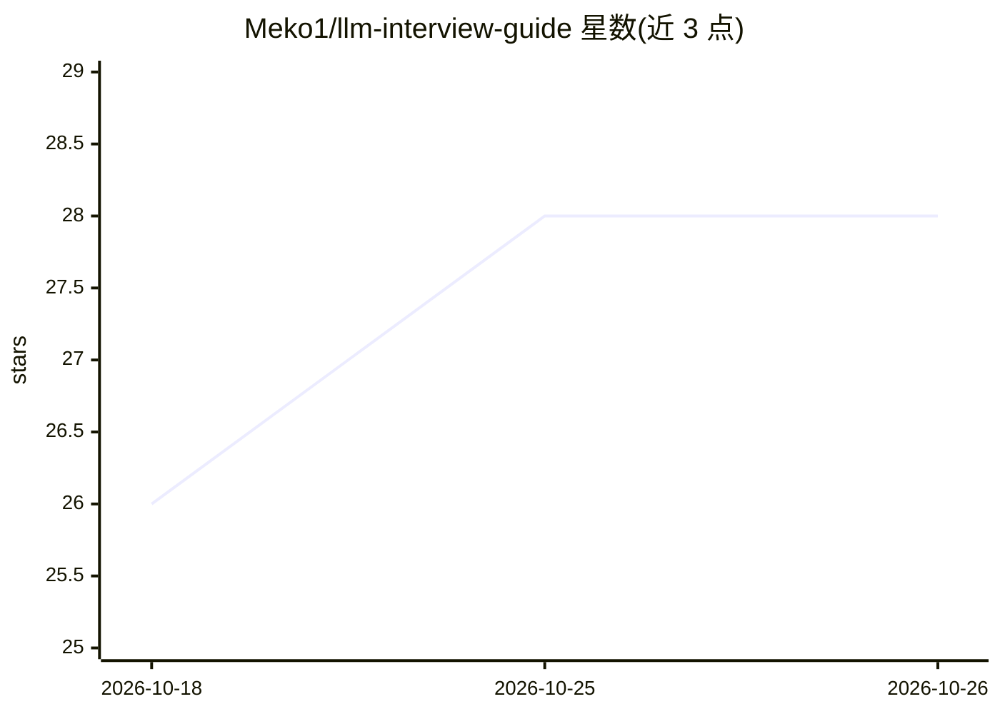

# Meko1/llm-interview-guide

⭐ 28 · JavaScript · MIT · 推送 2026-08-07 · [GitHub](https://github.com/Meko1/llm-interview-guide) · [官网](https://meko1.github.io/llm-interview-guide/) · 个人维护 · 中文 README

**面向中文读者的大模型面试知识库，问答式整理高频考点**

开源的大模型/LLM 面试知识库，基于 VitePress 构建静态站点并提供在线阅读。内容按新手入门、大模型基础（Transformer/Attention/MoE）、训练与微调（LoRA/RLHF/DPO）、应用开发（RAG/Agent/MCP）、推理部署（vLLM/量化/KV Cache）、评估与多模态、Claude Code 深入、前沿专题及分岗位面试题等章节组织，每篇文末附「高频追问」。适合准备大模型/AI 算法/AIGC 工程岗位面试者及入门开发者。本地运行需 Node.js 18+，MIT 许可。

## 筛选速览

| 维度 | 判定 | 备注 |
|---|---|---|
| AI 角色 | `ai-knowledge` | 知识聚合/清单类 |
| 许可风险 | `permissive` | MIT |
| 部署形态 | `library` | 以包/库形式分发 |
| 模型依赖 | — | README 未给出锁定关系 |
| 硬件要求 | — | 无带数字的原话,不猜 |
| 安装摩擦 | `low` | 无编译、无系统依赖或容器化 |
| 成熟度 | — | 结构信号不足 |

## 能力要点

- 从底层原理到工程落地的分章节知识体系
- 每篇文章末尾附模拟面试官追问的「高频追问」
- 含 10 道高频手撕题可运行题解（MHA/RoPE/LoRA/DPO）
- VitePress 站点，支持在线阅读与 GitHub Pages 自动部署

## 适用场景

- 面试前快速建立大模型知识全局认知并查漏补缺
- 后端工程师转型大模型方向的系统学习路线
- 按算法/应用/工程岗位查找对应面试真题

## 场景标签

`教程课程` · 领域:学习与行业

## 证据(README 行号)

> L15: LLMGuide 是一份开源的**大模型面试知识库**，把大模型方向零散的知识点整理成体系化、问答式的文档，帮你在面试前快速建立全局认知、查漏补缺。
> L22: > 适合：准备大模型 / AI 算法、AI 应用开发、AIGC 工程等岗位面试的同学，以及想系统入门大模型的开发者。

## 星数曲线

2026-10-18 26 → 2026-10-26 28（+2）

---
*卡片 v1 · prompt 1.4 · 生成 2026-10-26 · 置信度 high · 依据 README sha `dcef5421d556` · [字段定义](../../DATASET.md)*
