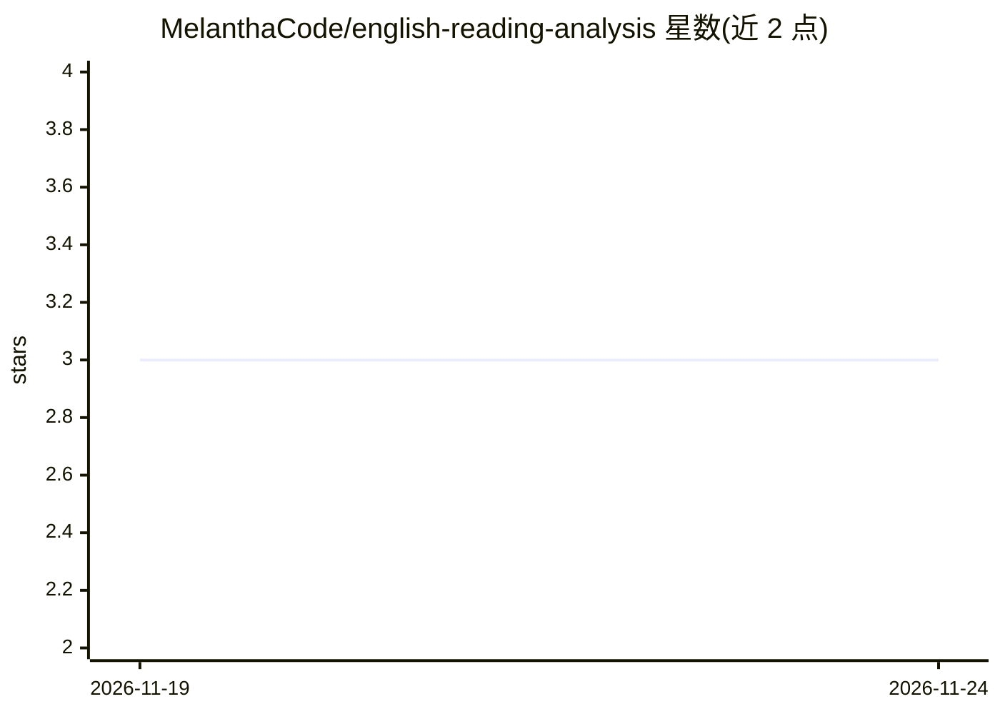

# MelanthaCode/english-reading-analysis

⭐ 3 · HTML · MIT · 推送 2026-11-21 · [GitHub](https://github.com/MelanthaCode/english-reading-analysis) · [官网](https://github.com/MelanthaCode/english-reading-analysis) · 个人维护 · 中文 README

**给 AI Agent 用的技能：英语试卷/文章转中文可打印解析**

一个 Agent Skill（SKILL.md 形态）：读取英语文章或试卷（文字版/扫描件/照片），生成逐段中文翻译、题目与选项中英对照及答案解析、错题分析与长难句句法拆解，输出 HTML 与可打印 A4 PDF。面向使用 Claude Code、Codex、Cursor 等 20+ Agent 工具的学习者。同一仓库含技能、DSH 插件、Claude Code 插件三种形态；PDF 渲染依赖本机 Chrome 系浏览器，脚本约 300 行纯标准库 Python，无构建步骤。

## 筛选速览

| 维度 | 判定 | 备注 |
|---|---|---|
| AI 角色 | `ai-native` | 本体是模型或模型工具 |
| 许可风险 | `permissive` | MIT |
| 部署形态 | `desktop` | 安装包/桌面程序 |
| 模型依赖 | — | README 未给出锁定关系 |
| 硬件要求 | — | 无带数字的原话,不猜 |
| 安装摩擦 | `low` | 无编译、无系统依赖或容器化 |
| 成熟度 | — | 结构信号不足 |

## 能力要点

- 逐段英译中，题目选项对照翻译且答案回指原文位置
- 长难句拆解：左栏句/从句级框架，右栏保留原词序并标成分
- HTML + headless Chrome 渲染 A4 PDF，卡片与题块不跨页
- 四级渲染降级链，渲染不可用时交付 HTML 仍完成任务

## 适用场景

- 把英语试卷翻成中文并给出答案与解析
- 批改后让 AI 归类错因并拆解每篇难句
- 生成可直接打印的 A4 英语学习材料

## 场景标签

 · 领域:教育/语言学习工具

## 证据(README 行号)

> L15: 一个给 AI Agent 用的技能：把**英语阅读材料转成中文**——文章逐段翻译，试卷题目与选项翻译并给出答案，复杂长难句做句法拆解，最后输出一份可打印的 A4 文档。
> L118: 只要工具支持 **Agent Skills** 约定（`SKILL.md` + 同目录资源），把它放进技能目录即可，无需为每家厂商改代码。

## 星数曲线

2026-11-19 3 → 2026-11-24 3（+0）

---
*卡片 v1 · prompt 1.4 · 生成 2026-11-22 · 置信度 mid · 依据 README sha `c445a83af399` · [字段定义](../../DATASET.md)*
