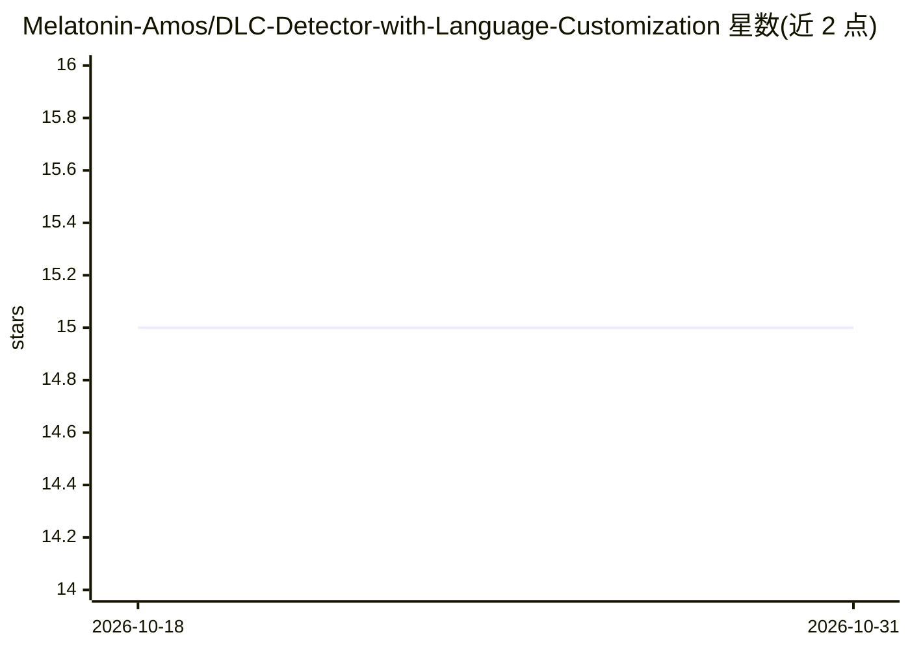

# Melatonin-Amos/DLC-Detector-with-Language-Customization

⭐ 15 · Python · MIT · 推送 2025-12-26 · [GitHub](https://github.com/Melatonin-Amos/DLC-Detector-with-Language-Customization) · 组织维护 · 中文 README

**基于 CLIP/FG-CLIP 的零样本场景识别智能养老摄像头系统**

上海交通大学 ME1221 课程项目：利用 CLIP 与 FG-CLIP2 预训练视觉语言模型进行 zero-shot 场景识别，检测跌倒、火灾等紧急场景，支持中文 Prompt 配置、Hydra 配置系统、Tkinter GUI 实时预览、摄像头/本地视频输入，检测到高危场景可通过 SMTP 发送带截图的邮件警报。可选接入 Gemini/DeepSeek API 由 AI 辅助生成自定义场景配置，基础检测无需 API 密钥。从源码运行，需 Python 3.10+，GPU（CUDA 11.0+、4GB 显存）为推荐配置，CPU 模式可用但较慢。

## 筛选速览

| 维度 | 判定 | 备注 |
|---|---|---|
| AI 角色 | `ai-native` | 本体是模型或模型工具 |
| 许可风险 | `permissive` | MIT |
| 部署形态 | `None` |  |
| 模型依赖 | — | README 未给出锁定关系 |
| 硬件要求 | — | 无带数字的原话,不猜 |
| 安装摩擦 | `medium` | 含编译或系统依赖之一 |
| 成熟度 | — | 结构信号不足 |

## 能力要点

- CLIP / FG-CLIP 2 双模型 zero-shot 场景检测，无需训练
- YAML + Hydra 场景自定义与 GUI 可视化配置
- 高危场景 SMTP 邮件警报（附警报帧截图）
- 可选 AI（Gemini/DeepSeek）自动生成场景配置

## 适用场景

- 养老监护场景下检测跌倒、火灾等紧急情况并邮件报警
- 通过自定义 Prompt 配置个性化检测场景
- 用摄像头实时流或本地视频文件进行场景检测

## 场景标签

`目标检测` · 领域:感知与多模态

## 证据(README 行号)

> L20: 这是上海交通大学电子信息与电气工程学部的一群大一学生在 工程学导论（ME1221） 课程中开发的项目。本项目实现了一个**基于 VLM 的支持语义定制的智能养老摄像头系统**，利用大规模预训练视觉语言模型进行 zero-shot 
> L24: - 🎯 **Zero-shot 场景检测**：无需训练即可识别跌倒、火灾等紧急场景

## 星数曲线

2026-10-18 15 → 2026-10-31 15（+0）

---
*卡片 v1 · prompt 1.4 · 生成 2026-10-30 · 置信度 high · 依据 README sha `6485ee94288f` · [字段定义](../../DATASET.md)*
